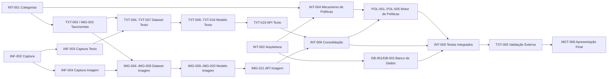

# ORCA — Product Backlog e Planejamento do Projeto

## Visão Geral do Projeto

O **ORCA** é um sistema executado em nível de máquina, associado ao uso de um navegador, que analisa o conteúdo textual e o conteúdo visual (imagens) das páginas acessadas durante a navegação, submetendo-os a dois modelos complementares de inteligência artificial — um de **Processamento de Linguagem Natural (PLN)** para texto e um de **Visão Computacional** para imagens — treinados ou ajustados (*fine-tuned*) pela equipe. As classificações produzidas por ambos os modelos são consolidadas por um **mecanismo de políticas**, responsável por decidir se o conteúdo deve ser **permitido**, **bloqueado** ou gerar um **alerta**, de acordo com regras definidas por categoria.

O sistema registra as classificações e ações tomadas (URL/domínio, modalidade, categoria, score de confiança, ação e data/hora), possibilitando a apresentação de histórico e estatísticas de uso por meio de uma interface de acompanhamento voltada a responsáveis com baixo ou nenhum conhecimento técnico.

**Escopo deste semestre:** construção e validação dos motores de classificação textual e de imagem, do mecanismo de consolidação/políticas e de sua aplicação em nível de máquina associada a um navegador.

**Fora do escopo deste semestre** (tratados apenas como evolução futura, sem consumir tarefas das sprints atuais): implementação de gateway de rede em Raspberry Pi, identificação de usuários/dispositivos por endereço IP, aplicação centralizada de políticas para múltiplos dispositivos e análise de tráfego criptografado ponto a ponto.

## Equipe

| Integrante | Responsabilidade principal | Papel no time |
|---|---|---|
| Jhenifer Laís Barbosa | Inteligência Artificial de Texto / PLN | Arquitetura do pipeline textual, implementação, treinamento, métricas e API do classificador de texto |
| Eduarda "Duda" Luiza Pinheiro Nepomuceno | Inteligência Artificial de Texto / PLN | Pesquisa, datasets, rotulagem, pré-processamento, validação e documentação do classificador de texto |
| Jean Yuki Kimura | Inteligência Artificial de Imagem / Visão Computacional | Arquitetura do pipeline visual, implementação, treinamento, fine-tuning e API do classificador de imagem |
| João Pedro Duarte Giatti | Inteligência Artificial de Imagem / Visão Computacional | Pesquisa, datasets de imagem, pré-processamento, validação, métricas e testes de casos extremos |

Orientadora: Sílvia Cristina de Matos Soares.

## Áreas do Projeto

| Prefixo | Área |
|---|---|
| `TXT` | IA — Texto |
| `IMG` | IA — Imagem |
| `INT` | Integração (categorias, arquitetura, consolidação multimodal) |
| `POL` | Backend — Mecanismo de Políticas |
| `INF` | Infraestrutura (agente em nível de máquina, ambiente) |
| `DB` | Banco de Dados |
| `LOG` | Monitoramento (logs, histórico, interface de estatísticas) |
| `TST` | Testes |
| `DOC` | Documentação |
| `MGT` | Gestão do Projeto |

## Estratégia de Sprints

O projeto é organizado em **5 Sprints** ao longo do semestre, seguindo uma evolução lógica de pesquisa → dados → modelos → integração → validação, compatível com a metodologia **Scrum** (planejamento, execução e retrospectiva a cada Sprint — tarefas `MGT-00X`).

- **Sprint 1 — Pesquisa e Planejamento:** entender o problema, definir categorias de classificação, pesquisar datasets e modelos de PLN/visão computacional, definir a arquitetura geral e preparar o ambiente de desenvolvimento.
- **Sprint 2 — Dados e Pré-processamento:** obter e documentar as bases de dados textual e de imagem, implementar os pipelines de limpeza/normalização e realizar a separação treino/validação/teste.
- **Sprint 3 — Desenvolvimento dos Modelos:** implementar baselines, treinar/ajustar os modelos de PLN e visão computacional, testar abordagens alternativas e registrar as primeiras métricas.
- **Sprint 4 — Integração e Otimização:** otimizar os modelos, criar as APIs de classificação, implementar o mecanismo de políticas e consolidar as classificações textual e visual.
- **Sprint 5 — Testes, Validação e Documentação:** executar testes integrados, avaliar o sistema em casos extremos, validar o protótipo com a comunidade externa e concluir a documentação técnica e final.

Todas as tarefas ligadas a requisitos **Essenciais** estão concentradas nas Sprints 1 a 4; tarefas ligadas a requisitos **Desejáveis** foram posicionadas na Sprint 5 e marcadas como prototipação/evolução opcional.

---

# Sprint 1

**Objetivo:** Entender o problema, definir categorias de classificação de conteúdo, pesquisar datasets e modelos de PLN e visão computacional, definir a arquitetura geral do sistema e o mecanismo de políticas, e preparar o ambiente de desenvolvimento da equipe.

## Tasks

### Visão geral da Sprint 1

| ID | Área | Responsável(is) | Prioridade | Estimativa |
|---|---|---|---|---|
| MGT-001 | Gestão de Projeto | Todos | Essencial | 3h |
| MGT-002 | Gestão de Projeto | Todos | Essencial | 3h |
| MGT-003 | Gestão de Projeto | Todos | Importante | 3h |
| INT-001 | Integração | Todos | Essencial | 8h |
| INT-002 | Integração | Todos | Essencial | 8h |
| INT-003 | Integração | Todos | Essencial | 6h |
| INT-004 | Integração | Todos | Essencial | 6h |
| INF-001 | Infraestrutura | Todos | Essencial | 4h |
| INF-002 | Infraestrutura | Jhenifer, Jean | Essencial | 8h |
| TXT-001 | IA — Texto | Duda | Essencial | 6h |
| TXT-002 | IA — Texto | Duda | Essencial | 6h |
| TXT-003 | IA — Texto | Duda, Jhenifer | Essencial | 4h |
| IMG-001 | IA — Imagem | Jean | Essencial | 6h |
| IMG-002 | IA — Imagem | Giatti | Essencial | 6h |
| IMG-003 | IA — Imagem | Giatti, Jean | Essencial | 4h |

## MGT-001 — Configurar repositório e quadro do projeto no GitHub Projects

**Área:** Gestão de Projeto
**Responsáveis:** Jhenifer, Duda, Jean, Giatti
**Prioridade:** Essencial
**Sprint:** Sprint 1
**Status inicial:** Todo
**Estimativa:** 3h

### Descrição

Criar o repositório do projeto (ou organizar o existente), configurar o GitHub Project com as colunas do fluxo Scrum (Backlog, Todo, Em andamento, Em revisão, Concluído) e importar as tarefas deste backlog como Issues, associando labels de área (`TXT`, `IMG`, `INT`, `POL`, `INF`, `DB`, `LOG`, `TST`, `DOC`, `MGT`) e de prioridade.

### Requisitos relacionados

- Nenhum requisito específico (apoio à gestão do projeto)

### Critérios de aceite

- [ ] Quadro do GitHub Projects criado com as colunas do fluxo Scrum definidas
- [ ] Labels de área e prioridade criadas e aplicadas às Issues iniciais
- [ ] Todas as tarefas da Sprint 1 importadas como Issues vinculadas ao quadro

### Dependências

- Nenhuma

### Entregável

Quadro do GitHub Projects publicado e acessível a toda a equipe, com as Issues da Sprint 1 organizadas.

## MGT-002 — Definir Definition of Ready, Definition of Done e processo Scrum da equipe

**Área:** Gestão de Projeto
**Responsáveis:** Jhenifer, Duda, Jean, Giatti
**Prioridade:** Essencial
**Sprint:** Sprint 1
**Status inicial:** Todo
**Estimativa:** 3h

### Descrição

Definir em conjunto os critérios de "pronto para iniciar" (Definition of Ready) e "concluído" (Definition of Done) para as tarefas do backlog, além da cadência das cerimônias Scrum (planejamento, revisão e retrospectiva por Sprint) que serão seguidas durante o semestre.

### Requisitos relacionados

- Nenhum requisito específico (apoio à gestão do projeto)

### Critérios de aceite

- [ ] Definition of Ready documentada e aplicável às tarefas do backlog
- [ ] Definition of Done documentada, incluindo critérios de revisão de código/artefatos
- [ ] Calendário das cerimônias Scrum das 5 Sprints definido e compartilhado com a equipe

### Dependências

- Nenhuma

### Entregável

Documento curto (no repositório ou wiki) com DoR, DoD e o calendário de cerimônias do semestre.

## MGT-003 — Planejamento, revisão e retrospectiva da Sprint 1

**Área:** Gestão de Projeto
**Responsáveis:** Jhenifer, Duda, Jean, Giatti
**Prioridade:** Importante
**Sprint:** Sprint 1
**Status inicial:** Todo
**Estimativa:** 3h

### Descrição

Conduzir a reunião de planejamento da Sprint 1 (seleção e estimativa das tarefas), a revisão de final de sprint (o que foi entregue) e a retrospectiva (o que funcionou e o que deve mudar na Sprint 2).

### Requisitos relacionados

- Nenhum requisito específico (apoio à gestão do projeto)

### Critérios de aceite

- [ ] Ata de planejamento da Sprint 1 registrada
- [ ] Ata de revisão com o status de cada tarefa registrada
- [ ] Ao menos 2 ações de melhoria levantadas na retrospectiva e registradas para a Sprint 2

### Dependências

- MGT-001
- MGT-002

### Entregável

Registro (documento ou Issue) com as atas de planejamento, revisão e retrospectiva da Sprint 1.

## INT-001 — Definir categorias de classificação de conteúdo (texto e imagem)

**Área:** Integração
**Responsáveis:** Jhenifer, Duda, Jean, Giatti
**Prioridade:** Essencial
**Sprint:** Sprint 1
**Status inicial:** Todo
**Estimativa:** 8h

### Descrição

Definir, em conjunto, a taxonomia de categorias de conteúdo (ex.: seguro/neutro, e demais categorias de conteúdo sensível relevantes ao cenário de controle de acesso) que servirá de base tanto para o classificador textual quanto para o classificador de imagem, garantindo que ambos operem sobre o mesmo conjunto de rótulos para viabilizar a consolidação posterior (RF18).

### Requisitos relacionados

- RIA01
- RIC01
- RIM01

### Critérios de aceite

- [ ] Lista de categorias definida, com descrição objetiva de cada uma
- [ ] Categorias validadas como aplicáveis tanto ao domínio textual quanto ao visual
- [ ] Documento de categorias aprovado pela orientadora/comunidade externa

### Dependências

- Nenhuma

### Entregável

Documento de taxonomia de categorias de conteúdo, referenciado por TXT-003, IMG-003 e pelo mecanismo de políticas (INT-004).

## INT-002 — Definir arquitetura geral do sistema e fluxo de dados entre módulos

**Área:** Integração
**Responsáveis:** Jhenifer, Duda, Jean, Giatti
**Prioridade:** Essencial
**Sprint:** Sprint 1
**Status inicial:** Todo
**Estimativa:** 8h

### Descrição

Definir a arquitetura geral do sistema, incluindo os módulos de captura de conteúdo (texto e imagem), classificador de PLN, classificador de visão computacional, motor de consolidação/políticas, banco de dados e interface de acompanhamento, mantendo as responsabilidades de classificação e de decisão separadas (RNF08) e prevendo pontos de extensão para a futura integração com Raspberry Pi (RNF09).

### Requisitos relacionados

- RNF08
- RNF09

### Critérios de aceite

- [ ] Diagrama de arquitetura elaborado, mostrando módulos e fluxo de dados
- [ ] Separação entre classificação (PLN/visão) e decisão (políticas) explicitada no diagrama
- [ ] Pontos de extensão para integração futura com infraestrutura de rede identificados e documentados

### Dependências

- Nenhuma

### Entregável

Diagrama e documento de arquitetura geral do sistema, versionado no repositório do projeto.

## INT-003 — Definir critério de precedência para consolidação texto/imagem

**Área:** Integração
**Responsáveis:** Jhenifer, Duda, Jean, Giatti
**Prioridade:** Essencial
**Sprint:** Sprint 1
**Status inicial:** Todo
**Estimativa:** 6h

### Descrição

Definir e documentar o critério de consolidação a ser aplicado quando as classificações textual e de imagem de uma mesma página divergirem (ex.: predomínio da categoria mais restritiva ou combinação ponderada dos scores), servindo de base para a implementação do módulo de consolidação (INT-006).

### Requisitos relacionados

- RF18
- RIM01

### Critérios de aceite

- [ ] Critério de consolidação escolhido e justificado tecnicamente
- [ ] Regras para casos de empate/divergência documentadas com exemplos
- [ ] Critério revisado e validado pela equipe antes da implementação

### Dependências

- INT-001

### Entregável

Documento com o critério de consolidação/precedência entre modalidades, insumo direto para INT-006 e DOC-004.

## INT-004 — Definir mecanismo de políticas (regras e ações permitir/bloquear/alertar)

**Área:** Integração
**Responsáveis:** Jhenifer, Duda, Jean, Giatti
**Prioridade:** Essencial
**Sprint:** Sprint 1
**Status inicial:** Todo
**Estimativa:** 6h

### Descrição

Definir o modelo de regras de política por categoria de conteúdo (permitir, bloquear ou alertar), incluindo a estrutura de configuração dessas regras e o comportamento esperado do sistema para cada ação, servindo de especificação para a implementação do motor de políticas (POL-001).

### Requisitos relacionados

- RF05
- RF06

### Critérios de aceite

- [ ] Estrutura de regra de política (categoria → ação) definida e documentada
- [ ] Comportamento de cada ação (permitir, bloquear, alertar) especificado
- [ ] Especificação revisada pela equipe e pronta para implementação em POL-001

### Dependências

- INT-001
- INT-002

### Entregável

Especificação do mecanismo de políticas, utilizada como base para POL-001 a POL-005.

## INF-001 — Preparar ambiente de desenvolvimento e repositório do projeto

**Área:** Infraestrutura
**Responsáveis:** Jhenifer, Duda, Jean, Giatti
**Prioridade:** Essencial
**Sprint:** Sprint 1
**Status inicial:** Todo
**Estimativa:** 4h

### Descrição

Configurar o repositório do projeto (estrutura de pastas para código, dados e documentação), ambientes virtuais/dependências para os módulos de PLN e visão computacional, e convenções mínimas de código a serem seguidas pela equipe.

### Requisitos relacionados

- Nenhum requisito específico (apoio à infraestrutura de desenvolvimento)

### Critérios de aceite

- [ ] Estrutura de pastas do repositório definida e documentada em um README
- [ ] Ambiente de desenvolvimento reproduzível (arquivo de dependências) criado para texto e para imagem
- [ ] Convenções mínimas de código (formatação, nomenclatura) documentadas

### Dependências

- Nenhuma

### Entregável

Repositório configurado com estrutura de pastas, dependências e README inicial do projeto.

## INF-002 — Pesquisar mecanismo de captura de conteúdo em nível de máquina

**Área:** Infraestrutura
**Responsáveis:** Jhenifer, Jean
**Prioridade:** Essencial
**Sprint:** Sprint 1
**Status inicial:** Todo
**Estimativa:** 8h

### Descrição

Pesquisar e comparar abordagens técnicas para capturar, em nível de máquina, o conteúdo textual e as imagens das páginas acessadas por um navegador (ex.: extensão de navegador, proxy local, instrumentação do processo do navegador), considerando as limitações impostas pelo uso de HTTPS e pela natureza dinâmica da web, e definir o navegador de referência do protótipo.

### Requisitos relacionados

- RF01
- RF14
- RNF10

### Critérios de aceite

- [ ] Ao menos duas abordagens de captura comparadas quanto a viabilidade e limitações
- [ ] Navegador de referência do protótipo escolhido e justificado
- [ ] Abordagem escolhida documentada, incluindo limitações conhecidas (ex.: conteúdo cifrado)

### Dependências

- Nenhuma

### Entregável

Documento de decisão técnica sobre o mecanismo de captura de conteúdo, base para INF-003 e INF-004.

## TXT-001 — Pesquisar modelos de PLN para classificação de conteúdo web

**Área:** IA — Texto
**Responsável:** Duda
**Prioridade:** Essencial
**Sprint:** Sprint 1
**Status inicial:** Todo
**Estimativa:** 6h

### Descrição

Pesquisar e comparar técnicas e modelos de processamento de linguagem natural aplicáveis à classificação de conteúdo textual de páginas web (ex.: modelos clássicos de bag-of-words/TF-IDF, embeddings, modelos transformer pré-treinados), considerando as restrições de execução em nível de máquina.

### Requisitos relacionados

- Nenhum requisito específico (insumo para RIA01, RIA05)

### Critérios de aceite

- [ ] Ao menos 3 abordagens/modelos de PLN comparados quanto a acurácia esperada, custo computacional e tempo de inferência
- [ ] Restrições de hardware/execução em nível de máquina consideradas na comparação
- [ ] Recomendação de modelo(s) candidato(s) documentada

### Dependências

- Nenhuma

### Entregável

Relatório de pesquisa com os modelos de PLN comparados e a recomendação para o baseline (TXT-008).

## TXT-002 — Pesquisar e comparar datasets públicos de classificação textual

**Área:** IA — Texto
**Responsável:** Duda
**Prioridade:** Essencial
**Sprint:** Sprint 1
**Status inicial:** Todo
**Estimativa:** 6h

### Descrição

Pesquisar datasets públicos de classificação de texto compatíveis com as categorias de conteúdo do projeto, avaliando volume, idioma, licença de uso e qualidade da rotulagem.

### Requisitos relacionados

- Nenhum requisito específico (insumo para RIA06)

### Critérios de aceite

- [ ] Ao menos 3 datasets públicos identificados e comparados
- [ ] Licença de uso de cada dataset verificada e compatível com o projeto acadêmico
- [ ] Dataset(s) recomendado(s) documentado(s), com justificativa

### Dependências

- Nenhuma

### Entregável

Relatório comparativo de datasets textuais, base para a seleção em TXT-004.

## TXT-003 — Refinar taxonomia de subcategorias para conteúdo textual

**Área:** IA — Texto
**Responsáveis:** Duda, Jhenifer
**Prioridade:** Essencial
**Sprint:** Sprint 1
**Status inicial:** Todo
**Estimativa:** 4h

### Descrição

A partir da taxonomia geral de categorias (INT-001), detalhar particularidades do domínio textual (ex.: padrões linguísticos, ambiguidade lexical) relevantes para orientar a rotulagem do dataset textual.

### Requisitos relacionados

- RIA01

### Critérios de aceite

- [ ] Categorias gerais mapeadas para o domínio textual sem conflito com INT-001
- [ ] Exemplos de textos por categoria documentados para orientar rotuladores
- [ ] Casos limítrofes/ambíguos entre categorias identificados

### Dependências

- INT-001

### Entregável

Guia de rotulagem textual, utilizado em TXT-005.

## IMG-001 — Pesquisar modelos de visão computacional para classificação de imagens

**Área:** IA — Imagem
**Responsável:** Jean
**Prioridade:** Essencial
**Sprint:** Sprint 1
**Status inicial:** Todo
**Estimativa:** 6h

### Descrição

Pesquisar e comparar arquiteturas de visão computacional aplicáveis à classificação de imagens de páginas web (ex.: CNNs pré-treinadas, modelos leves para inferência em CPU), considerando as restrições de execução em nível de máquina.

### Requisitos relacionados

- Nenhum requisito específico (insumo para RIC01, RIC05)

### Critérios de aceite

- [ ] Ao menos 3 arquiteturas/modelos de visão computacional comparados quanto a acurácia esperada, custo computacional e tempo de inferência
- [ ] Restrições de hardware/execução em nível de máquina consideradas na comparação
- [ ] Recomendação de modelo(s) candidato(s) documentada

### Dependências

- Nenhuma

### Entregável

Relatório de pesquisa com os modelos de visão computacional comparados e a recomendação para o baseline (IMG-009).

## IMG-002 — Pesquisar e comparar datasets públicos de imagens para classificação

**Área:** IA — Imagem
**Responsável:** Giatti
**Prioridade:** Essencial
**Sprint:** Sprint 1
**Status inicial:** Todo
**Estimativa:** 6h

### Descrição

Pesquisar datasets públicos de imagens compatíveis com as categorias de conteúdo do projeto, avaliando volume, licença de uso e qualidade da rotulagem.

### Requisitos relacionados

- Nenhum requisito específico (insumo para RIC06)

### Critérios de aceite

- [ ] Ao menos 3 datasets públicos de imagens identificados e comparados
- [ ] Licença de uso de cada dataset verificada e compatível com o projeto acadêmico
- [ ] Dataset(s) recomendado(s) documentado(s), com justificativa

### Dependências

- Nenhuma

### Entregável

Relatório comparativo de datasets de imagem, base para a seleção em IMG-004.

## IMG-003 — Refinar taxonomia de subcategorias para conteúdo visual

**Área:** IA — Imagem
**Responsáveis:** Giatti, Jean
**Prioridade:** Essencial
**Sprint:** Sprint 1
**Status inicial:** Todo
**Estimativa:** 4h

### Descrição

A partir da taxonomia geral de categorias (INT-001), detalhar particularidades do domínio visual (ex.: elementos visuais característicos de cada categoria) relevantes para orientar a rotulagem do dataset de imagens.

### Requisitos relacionados

- RIC01

### Critérios de aceite

- [ ] Categorias gerais mapeadas para o domínio visual sem conflito com INT-001
- [ ] Exemplos de imagens por categoria documentados para orientar rotuladores
- [ ] Casos limítrofes/ambíguos entre categorias identificados

### Dependências

- INT-001

### Entregável

Guia de rotulagem de imagens, utilizado em IMG-005.

---

# Sprint 2

**Objetivo:** Obter e validar as bases de dados textual e de imagem, implementar os pipelines de pré-processamento de cada modalidade e realizar a separação em conjuntos de treino, validação e teste, além de modelar a base de dados de registros/logs.

## Tasks

### Visão geral da Sprint 2

| ID | Área | Responsável(is) | Prioridade | Estimativa |
|---|---|---|---|---|
| MGT-004 | Gestão de Projeto | Todos | Importante | 3h |
| INT-005 | Integração | Jhenifer, Jean | Essencial | 5h |
| INF-003 | Infraestrutura | Jhenifer | Essencial | 8h |
| INF-004 | Infraestrutura | Jean | Essencial | 8h |
| INF-006 | Infraestrutura | Jean, Jhenifer | Essencial | 4h |
| DB-001 | Banco de Dados | Jhenifer | Essencial | 5h |
| DB-002 | Banco de Dados | Jhenifer | Essencial | 6h |
| DOC-001 | Documentação | Jhenifer, Jean | Importante | 5h |
| DOC-002 | Documentação | Duda, Giatti | Importante | 5h |
| TXT-004 | IA — Texto | Duda | Essencial | 8h |
| TXT-005 | IA — Texto | Duda | Essencial | 10h |
| TXT-006 | IA — Texto | Jhenifer, Duda | Essencial | 6h |
| TXT-007 | IA — Texto | Duda | Essencial | 4h |
| IMG-004 | IA — Imagem | Giatti | Essencial | 8h |
| IMG-005 | IA — Imagem | Giatti | Essencial | 10h |
| IMG-006 | IA — Imagem | Jean | Essencial | 6h |
| IMG-007 | IA — Imagem | Jean | Essencial | 5h |
| IMG-008 | IA — Imagem | Giatti | Essencial | 4h |

## MGT-004 — Planejamento, revisão e retrospectiva da Sprint 2

**Área:** Gestão de Projeto
**Responsáveis:** Jhenifer, Duda, Jean, Giatti
**Prioridade:** Importante
**Sprint:** Sprint 2
**Status inicial:** Todo
**Estimativa:** 3h

### Descrição

Conduzir o planejamento, a revisão e a retrospectiva da Sprint 2, avaliando o progresso na obtenção e preparação das bases de dados e ajustando o backlog da Sprint 3 conforme necessário.

### Requisitos relacionados

- Nenhum requisito específico (apoio à gestão do projeto)

### Critérios de aceite

- [ ] Ata de planejamento da Sprint 2 registrada
- [ ] Ata de revisão com o status de cada tarefa registrada
- [ ] Ações de melhoria da retrospectiva registradas para a Sprint 3

### Dependências

- MGT-003

### Entregável

Registro das atas de planejamento, revisão e retrospectiva da Sprint 2.

## INT-005 — Especificar contrato de API entre classificadores e motor de políticas

**Área:** Integração
**Responsáveis:** Jhenifer, Jean
**Prioridade:** Essencial
**Sprint:** Sprint 2
**Status inicial:** Todo
**Estimativa:** 5h

### Descrição

Especificar o contrato de dados (formato de requisição/resposta) que os endpoints de classificação textual (TXT-019) e de imagem (IMG-021) deverão seguir, incluindo categoria, score de confiança e identificação da versão do modelo, para permitir a consolidação pelo motor de políticas.

### Requisitos relacionados

- Nenhum requisito específico (insumo técnico para RF18, RIA08, RIC08)

### Critérios de aceite

- [ ] Esquema de request/response definido para o endpoint de classificação textual
- [ ] Esquema de request/response definido para o endpoint de classificação de imagem
- [ ] Campos de score de confiança e versão do modelo presentes em ambos os esquemas

### Dependências

- INT-002
- INT-004

### Entregável

Documento de contrato de API (ex.: especificação OpenAPI ou similar) compartilhado pelas equipes de texto e imagem.

## INF-003 — Implementar módulo de captura do conteúdo textual das páginas

**Área:** Infraestrutura
**Responsável:** Jhenifer
**Prioridade:** Essencial
**Sprint:** Sprint 2
**Status inicial:** Todo
**Estimativa:** 8h

### Descrição

Implementar, em nível de máquina, o módulo responsável por obter o conteúdo textual das páginas acessadas pelo navegador durante a navegação, de acordo com a abordagem definida em INF-002.

### Requisitos relacionados

- RF01

### Critérios de aceite

- [ ] Módulo captura o texto principal de páginas de teste em diferentes domínios
- [ ] Módulo lida de forma controlada com páginas sem conteúdo textual extraível
- [ ] Limitações conhecidas (ex.: conteúdo carregado dinamicamente) documentadas

### Dependências

- INF-002

### Entregável

Módulo de captura de conteúdo textual integrado ao agente em nível de máquina.

## INF-004 — Implementar módulo de captura de imagens das páginas

**Área:** Infraestrutura
**Responsável:** Jean
**Prioridade:** Essencial
**Sprint:** Sprint 2
**Status inicial:** Todo
**Estimativa:** 8h

### Descrição

Implementar, em nível de máquina, o módulo responsável por obter as imagens presentes nas páginas acessadas pelo navegador durante a navegação, de acordo com a abordagem definida em INF-002.

### Requisitos relacionados

- RF14

### Critérios de aceite

- [ ] Módulo captura imagens de páginas de teste em diferentes domínios
- [ ] Módulo lida de forma controlada com páginas sem imagens relevantes
- [ ] Limitações conhecidas (ex.: imagens carregadas dinamicamente) documentadas

### Dependências

- INF-002

### Entregável

Módulo de captura de imagens integrado ao agente em nível de máquina.

## INF-006 — Validar compatibilidade do agente com o navegador escolhido

**Área:** Infraestrutura
**Responsáveis:** Jean, Jhenifer
**Prioridade:** Essencial
**Sprint:** Sprint 2
**Status inicial:** Todo
**Estimativa:** 4h

### Descrição

Validar que os módulos de captura de texto e de imagem funcionam corretamente com o navegador de referência definido em INF-002, cobrindo cenários básicos de navegação (múltiplas abas, navegação por links, páginas com HTTPS).

### Requisitos relacionados

- RNF10

### Critérios de aceite

- [ ] Captura de texto e de imagem validada em ao menos 10 páginas reais distintas
- [ ] Comportamento do agente documentado para páginas HTTPS
- [ ] Falhas de compatibilidade identificadas registradas como limitações conhecidas

### Dependências

- INF-002

### Entregável

Relatório de validação de compatibilidade do agente com o navegador escolhido.

## DB-001 — Modelar estrutura de dados para classificações, logs e estatísticas

**Área:** Banco de Dados
**Responsável:** Jhenifer
**Prioridade:** Essencial
**Sprint:** Sprint 2
**Status inicial:** Todo
**Estimativa:** 5h

### Descrição

Modelar a estrutura de dados (entidades e relacionamentos) necessária para armazenar cada classificação realizada — URL/domínio, modalidade, categoria, score de confiança, ação tomada e data/hora — de forma a suportar consultas de histórico e estatísticas.

### Requisitos relacionados

- RF08

### Critérios de aceite

- [ ] Modelo de dados (ex.: MER ou diagrama equivalente) elaborado e documentado
- [ ] Todos os campos exigidos pelo RF08 presentes no modelo
- [ ] Modelo revisado quanto à capacidade de suportar as estatísticas exigidas por RF10

### Dependências

- INT-002

### Entregável

Diagrama e documento do modelo de dados de classificações e logs, base para DB-002.

## DB-002 — Implementar esquema de banco de dados para histórico e estatísticas

**Área:** Banco de Dados
**Responsável:** Jhenifer
**Prioridade:** Essencial
**Sprint:** Sprint 2
**Status inicial:** Todo
**Estimativa:** 6h

### Descrição

Implementar o esquema de banco de dados definido em DB-001, incluindo scripts de criação das tabelas/coleções e funções básicas de inserção e consulta a serem usadas pelo módulo de logging (LOG-001) e pela interface de acompanhamento (LOG-003).

### Requisitos relacionados

- RF08
- RF09

### Critérios de aceite

- [ ] Esquema de banco de dados criado a partir do modelo de DB-001
- [ ] Funções de inserção de registro de classificação implementadas e testadas
- [ ] Funções de consulta de histórico por período/categoria implementadas e testadas

### Dependências

- DB-001

### Entregável

Banco de dados implementado com scripts de criação e funções básicas de acesso, prontos para uso por LOG-001 e LOG-003.

## DOC-001 — Documentar arquitetura geral do sistema

**Área:** Documentação
**Responsáveis:** Jhenifer, Jean
**Prioridade:** Importante
**Sprint:** Sprint 2
**Status inicial:** Todo
**Estimativa:** 5h

### Descrição

Redigir a documentação da arquitetura geral do sistema a partir da definição de INT-002, incluindo diagrama, descrição dos módulos e tecnologias utilizadas, para uso no relatório final do projeto.

### Requisitos relacionados

- RNF08

### Critérios de aceite

- [ ] Documento de arquitetura redigido com diagrama atualizado
- [ ] Tecnologias, linguagens e frameworks utilizados listados por módulo
- [ ] Documento revisado por ao menos um integrante de cada dupla (texto/imagem)

### Dependências

- INT-002

### Entregável

Seção de arquitetura e tecnologias pronta para o relatório final do projeto.

## DOC-002 — Documentar bases de dados textual e de imagem

**Área:** Documentação
**Responsáveis:** Duda, Giatti
**Prioridade:** Importante
**Sprint:** Sprint 2
**Status inicial:** Todo
**Estimativa:** 5h

### Descrição

Documentar a origem, o volume, a licença e a distribuição entre categorias das bases de dados textual e de imagem selecionadas, incluindo o processo de rotulagem utilizado.

### Requisitos relacionados

- RIA06
- RIC06

### Critérios de aceite

- [ ] Origem, volume e licença de cada base de dados documentados
- [ ] Distribuição de exemplos por categoria apresentada (ex.: tabela ou gráfico)
- [ ] Processo de rotulagem/anotação descrito para ambas as modalidades

### Dependências

- TXT-004
- IMG-004

### Entregável

Seção de "Base de Dados" pronta para o relatório final do projeto.

## TXT-004 — Selecionar base de dados textual e documentar origem e volume

**Área:** IA — Texto
**Responsável:** Duda
**Prioridade:** Essencial
**Sprint:** Sprint 2
**Status inicial:** Todo
**Estimativa:** 8h

### Descrição

A partir da pesquisa de TXT-002 e da taxonomia de TXT-003, selecionar e obter a(s) base(s) de dados textual(is) a ser(em) utilizada(s) no treinamento, documentando sua origem, volume total e distribuição entre categorias.

### Requisitos relacionados

- RIA06

### Critérios de aceite

- [ ] Base de dados textual obtida e armazenada no formato definido pela equipe
- [ ] Volume total de exemplos e distribuição por categoria documentados
- [ ] Origem e licença da base registradas

### Dependências

- TXT-002
- TXT-003

### Entregável

Base de dados textual bruta armazenada e documento descritivo do dataset.

## TXT-005 — Rotular base de dados textual conforme categorias definidas

**Área:** IA — Texto
**Responsável:** Duda
**Prioridade:** Essencial
**Sprint:** Sprint 2
**Status inicial:** Todo
**Estimativa:** 10h

### Descrição

Rotular (ou validar rótulos existentes d)a base de dados textual selecionada, de acordo com as categorias e o guia de rotulagem definidos em TXT-003, garantindo consistência entre os exemplos.

### Requisitos relacionados

- RIA06

### Critérios de aceite

- [ ] 100% dos exemplos selecionados para uso possuem rótulo de categoria
- [ ] Amostra de rótulos revisada em dupla para checagem de consistência
- [ ] Casos ambíguos identificados durante a rotulagem documentados

### Dependências

- TXT-004

### Entregável

Base de dados textual rotulada, pronta para o pipeline de pré-processamento (TXT-006).

## TXT-006 — Criar pipeline de limpeza e normalização textual

**Área:** IA — Texto
**Responsáveis:** Jhenifer, Duda
**Prioridade:** Essencial
**Sprint:** Sprint 2
**Status inicial:** Todo
**Estimativa:** 6h

### Descrição

Implementar o pipeline de pré-processamento do conteúdo textual (limpeza de HTML/ruído, normalização, remoção de stopwords quando aplicável) a ser utilizado tanto no treinamento do modelo quanto na classificação em tempo real do conteúdo capturado por INF-003.

### Requisitos relacionados

- RF02

### Critérios de aceite

- [ ] Pipeline remove ruído comum de páginas web (tags HTML, scripts, navegação)
- [ ] Pipeline normaliza o texto (case, acentuação/pontuação conforme decisão da equipe)
- [ ] Pipeline testado com textos reais capturados por INF-003

### Dependências

- INF-003

### Entregável

Módulo de pré-processamento textual reutilizável pelo treinamento (TXT-008) e pela classificação em produção (TXT-019).

## TXT-007 — Separar dataset textual em treino, validação e teste

**Área:** IA — Texto
**Responsável:** Duda
**Prioridade:** Essencial
**Sprint:** Sprint 2
**Status inicial:** Todo
**Estimativa:** 4h

### Descrição

Dividir a base de dados textual rotulada em conjuntos de treino, validação e teste, garantindo proporção adequada entre categorias e evitando vazamento de dados (*data leakage*) entre os conjuntos.

### Requisitos relacionados

- RIA07

### Critérios de aceite

- [ ] Divisão treino/validação/teste realizada com proporções documentadas
- [ ] Distribuição de categorias verificada em cada conjunto (estratificação)
- [ ] Ausência de exemplos duplicados entre os três conjuntos verificada

### Dependências

- TXT-005

### Entregável

Arquivos de treino, validação e teste do dataset textual, prontos para uso em TXT-008.

## IMG-004 — Selecionar base de imagens e documentar origem e volume

**Área:** IA — Imagem
**Responsável:** Giatti
**Prioridade:** Essencial
**Sprint:** Sprint 2
**Status inicial:** Todo
**Estimativa:** 8h

### Descrição

A partir da pesquisa de IMG-002 e da taxonomia de IMG-003, selecionar e obter a(s) base(s) de imagens a ser(em) utilizada(s) no treinamento, documentando sua origem, volume total e distribuição entre categorias.

### Requisitos relacionados

- RIC06

### Critérios de aceite

- [ ] Base de imagens obtida e armazenada no formato definido pela equipe
- [ ] Volume total de imagens e distribuição por categoria documentados
- [ ] Origem e licença da base registradas

### Dependências

- IMG-002
- IMG-003

### Entregável

Base de imagens bruta armazenada e documento descritivo do dataset.

## IMG-005 — Rotular base de imagens conforme categorias definidas

**Área:** IA — Imagem
**Responsável:** Giatti
**Prioridade:** Essencial
**Sprint:** Sprint 2
**Status inicial:** Todo
**Estimativa:** 10h

### Descrição

Rotular (ou validar rótulos existentes d)a base de imagens selecionada, de acordo com as categorias e o guia de rotulagem definidos em IMG-003, garantindo consistência entre os exemplos.

### Requisitos relacionados

- RIC06

### Critérios de aceite

- [ ] 100% das imagens selecionadas para uso possuem rótulo de categoria
- [ ] Amostra de rótulos revisada em dupla para checagem de consistência
- [ ] Imagens ambíguas ou de baixa qualidade identificadas e sinalizadas

### Dependências

- IMG-004

### Entregável

Base de imagens rotulada, pronta para o pipeline de pré-processamento (IMG-006).

## IMG-006 — Implementar pipeline de redimensionamento e normalização de imagens

**Área:** IA — Imagem
**Responsável:** Jean
**Prioridade:** Essencial
**Sprint:** Sprint 2
**Status inicial:** Todo
**Estimativa:** 6h

### Descrição

Implementar o pipeline de pré-processamento das imagens (redimensionamento e normalização) a ser utilizado tanto no treinamento do modelo quanto na classificação em tempo real das imagens capturadas por INF-004.

### Requisitos relacionados

- RF15

### Critérios de aceite

- [ ] Pipeline redimensiona imagens para a resolução esperada pelo modelo
- [ ] Pipeline normaliza os valores de pixel conforme exigido pela arquitetura escolhida
- [ ] Pipeline testado com imagens reais capturadas por INF-004

### Dependências

- INF-004

### Entregável

Módulo de pré-processamento visual reutilizável pelo treinamento (IMG-009) e pela classificação em produção (IMG-021).

## IMG-007 — Implementar filtragem de imagens irrelevantes (ícones e elementos de interface)

**Área:** IA — Imagem
**Responsável:** Jean
**Prioridade:** Essencial
**Sprint:** Sprint 2
**Status inicial:** Todo
**Estimativa:** 5h

### Descrição

Implementar um filtro que descarte imagens irrelevantes para a classificação (ícones, imagens de interface, banners de baixo valor informativo), com base em heurísticas de tamanho, formato ou proporção, antes do envio ao classificador de visão computacional.

### Requisitos relacionados

- RF15

### Critérios de aceite

- [ ] Critérios de filtragem (ex.: dimensão mínima, proporção) definidos e implementados
- [ ] Filtro testado em um conjunto de páginas reais, reduzindo o volume de imagens irrelevantes classificadas
- [ ] Taxa de falsos descartes (imagens relevantes descartadas) avaliada e documentada

### Dependências

- IMG-006

### Entregável

Módulo de filtragem de imagens irrelevantes integrado ao pipeline de pré-processamento visual.

## IMG-008 — Separar dataset de imagens em treino, validação e teste

**Área:** IA — Imagem
**Responsável:** Giatti
**Prioridade:** Essencial
**Sprint:** Sprint 2
**Status inicial:** Todo
**Estimativa:** 4h

### Descrição

Dividir a base de imagens rotulada em conjuntos de treino, validação e teste, garantindo proporção adequada entre categorias e evitando vazamento de dados entre os conjuntos.

### Requisitos relacionados

- RIC07

### Critérios de aceite

- [ ] Divisão treino/validação/teste realizada com proporções documentadas
- [ ] Distribuição de categorias verificada em cada conjunto (estratificação)
- [ ] Ausência de imagens duplicadas entre os três conjuntos verificada

### Dependências

- IMG-005

### Entregável

Arquivos de treino, validação e teste do dataset de imagens, prontos para uso em IMG-009.

---

# Sprint 3

**Objetivo:** Implementar os baselines dos classificadores textual e de imagem, treinar/ajustar os modelos, testar abordagens alternativas e registrar as primeiras métricas de desempenho de cada modalidade.

## Tasks

### Visão geral da Sprint 3

| ID | Área | Responsável(is) | Prioridade | Estimativa |
|---|---|---|---|---|
| MGT-005 | Gestão de Projeto | Todos | Importante | 3h |
| LOG-001 | Monitoramento | Jhenifer | Essencial | 6h |
| TXT-008 | IA — Texto | Jhenifer | Essencial | 8h |
| TXT-009 | IA — Texto | Jhenifer | Essencial | 12h |
| TXT-010 | IA — Texto | Jhenifer | Importante | 8h |
| TXT-011 | IA — Texto | Jhenifer | Essencial | 5h |
| TXT-012 | IA — Texto | Duda | Essencial | 5h |
| TXT-013 | IA — Texto | Duda | Essencial | 6h |
| TXT-014 | IA — Texto | Jhenifer | Essencial | 4h |
| TXT-018 | IA — Texto | Jhenifer | Essencial | 4h |
| IMG-009 | IA — Imagem | Jean | Essencial | 8h |
| IMG-010 | IA — Imagem | Jean | Essencial | 12h |
| IMG-011 | IA — Imagem | Jean | Importante | 8h |
| IMG-012 | IA — Imagem | Jean | Essencial | 5h |
| IMG-013 | IA — Imagem | Giatti | Essencial | 5h |
| IMG-014 | IA — Imagem | Giatti | Essencial | 6h |
| IMG-015 | IA — Imagem | Jean | Essencial | 4h |
| IMG-020 | IA — Imagem | Jean | Essencial | 4h |

## MGT-005 — Planejamento, revisão e retrospectiva da Sprint 3

**Área:** Gestão de Projeto
**Responsáveis:** Jhenifer, Duda, Jean, Giatti
**Prioridade:** Importante
**Sprint:** Sprint 3
**Status inicial:** Todo
**Estimativa:** 3h

### Descrição

Conduzir o planejamento, a revisão e a retrospectiva da Sprint 3, avaliando as primeiras métricas obtidas pelos dois classificadores e ajustando o backlog da Sprint 4.

### Requisitos relacionados

- Nenhum requisito específico (apoio à gestão do projeto)

### Critérios de aceite

- [ ] Ata de planejamento da Sprint 3 registrada
- [ ] Métricas preliminares de ambos os modelos apresentadas na revisão
- [ ] Ações de melhoria da retrospectiva registradas para a Sprint 4

### Dependências

- MGT-004

### Entregável

Registro das atas de planejamento, revisão e retrospectiva da Sprint 3.

## LOG-001 — Implementar registro (log) de cada classificação realizada

**Área:** Monitoramento
**Responsável:** Jhenifer
**Prioridade:** Essencial
**Sprint:** Sprint 3
**Status inicial:** Todo
**Estimativa:** 6h

### Descrição

Implementar o mecanismo que registra, no banco de dados criado em DB-002, cada classificação realizada — URL/domínio, modalidade (texto e/ou imagem), categoria atribuída, nível de confiança, ação tomada e data/hora.

### Requisitos relacionados

- RF08

### Critérios de aceite

- [ ] Cada classificação textual e de imagem gera um registro persistido no banco de dados
- [ ] Registro contém todos os campos exigidos por RF08
- [ ] Registro testado com classificações reais de ambas as modalidades

### Dependências

- DB-002
- INF-003
- INF-004

### Entregável

Módulo de logging integrado ao pipeline de classificação, gravando registros completos no banco de dados.

## TXT-008 — Implementar primeiro baseline do classificador textual

**Área:** IA — Texto
**Responsável:** Jhenifer
**Prioridade:** Essencial
**Sprint:** Sprint 3
**Status inicial:** Todo
**Estimativa:** 8h

### Descrição

Implementar a primeira versão (baseline) do classificador de PLN, utilizando o modelo recomendado em TXT-001 e os dados pré-processados em TXT-006/TXT-007, servindo como ponto de partida para o treinamento/fine-tuning.

### Requisitos relacionados

- RIA06

### Critérios de aceite

- [ ] Baseline treinado com o conjunto de treino e avaliado no conjunto de validação
- [ ] Código do baseline versionado no repositório
- [ ] Resultado preliminar (acurácia/F1 aproximados) registrado como referência

### Dependências

- TXT-001
- TXT-006
- TXT-007

### Entregável

Modelo baseline de classificação textual treinado e versionado, base para o treinamento em TXT-009.

## TXT-009 — Treinar ou ajustar (fine-tune) o modelo de PLN selecionado

**Área:** IA — Texto
**Responsável:** Jhenifer
**Prioridade:** Essencial
**Sprint:** Sprint 3
**Status inicial:** Todo
**Estimativa:** 12h

### Descrição

Treinar ou realizar o fine-tuning do modelo de PLN escolhido a partir do baseline (TXT-008), ajustando hiperparâmetros iniciais para melhorar o desempenho nas categorias definidas.

### Requisitos relacionados

- RIA06

### Critérios de aceite

- [ ] Modelo treinado/ajustado com o conjunto de treino completo
- [ ] Processo de treinamento documentado (hiperparâmetros, número de épocas, hardware utilizado)
- [ ] Checkpoint do modelo salvo e versionado

### Dependências

- TXT-008

### Entregável

Modelo de PLN treinado/ajustado, pronto para avaliação em TXT-011.

## TXT-010 — Testar abordagens alternativas de modelos de PLN

**Área:** IA — Texto
**Responsável:** Jhenifer
**Prioridade:** Importante
**Sprint:** Sprint 3
**Status inicial:** Todo
**Estimativa:** 8h

### Descrição

Testar ao menos uma abordagem alternativa de modelo de PLN (diferente arquitetura ou técnica de representação) em relação ao baseline, comparando resultados para orientar a escolha final do modelo.

### Requisitos relacionados

- Nenhum requisito específico (insumo para RIA01, RIA02)

### Critérios de aceite

- [ ] Ao menos uma abordagem alternativa treinada e avaliada no mesmo conjunto de validação
- [ ] Comparação de resultados entre baseline e abordagem alternativa documentada
- [ ] Decisão sobre qual abordagem seguir registrada com justificativa

### Dependências

- TXT-008

### Entregável

Relatório comparativo entre abordagens de PLN testadas.

## TXT-011 — Implementar script de avaliação de métricas do modelo textual

**Área:** IA — Texto
**Responsável:** Jhenifer
**Prioridade:** Essencial
**Sprint:** Sprint 3
**Status inicial:** Todo
**Estimativa:** 5h

### Descrição

Implementar o script/rotina de avaliação do modelo textual no conjunto de teste, calculando acurácia, precisão, recall e F1-score por categoria.

### Requisitos relacionados

- RIA01
- RIA02

### Critérios de aceite

- [ ] Script calcula acurácia geral e F1-score por categoria no conjunto de teste
- [ ] Resultados exportados em formato reutilizável (ex.: CSV/JSON) para análise
- [ ] Script documentado e reprodutível por outro integrante da equipe

### Dependências

- TXT-009

### Entregável

Script de avaliação de métricas do modelo textual, reutilizado em TXT-012 e TXT-013.

## TXT-012 — Analisar F1-score e acurácia por categoria do modelo textual

**Área:** IA — Texto
**Responsável:** Duda
**Prioridade:** Essencial
**Sprint:** Sprint 3
**Status inicial:** Todo
**Estimativa:** 5h

### Descrição

Analisar os resultados de acurácia e F1-score por categoria gerados por TXT-011, identificando categorias com desempenho insatisfatório e possíveis causas (ex.: poucos exemplos, ambiguidade de rótulos).

### Requisitos relacionados

- RIA02

### Critérios de aceite

- [ ] F1-score de cada categoria comparado com a meta definida pela equipe
- [ ] Categorias com desempenho abaixo da meta identificadas e investigadas
- [ ] Recomendações de melhoria (dados ou modelo) documentadas para TXT-016

### Dependências

- TXT-011

### Entregável

Relatório de análise de métricas por categoria do modelo textual.

## TXT-013 — Analisar falsos positivos e falsos negativos do modelo textual

**Área:** IA — Texto
**Responsável:** Duda
**Prioridade:** Essencial
**Sprint:** Sprint 3
**Status inicial:** Todo
**Estimativa:** 6h

### Descrição

Analisar os erros de classificação do modelo textual no conjunto de teste, calculando as taxas de falsos positivos e falsos negativos por categoria, com atenção especial às categorias de conteúdo sensível.

### Requisitos relacionados

- RIA03
- RIA04

### Critérios de aceite

- [ ] Taxa de falsos negativos calculada para as categorias de conteúdo sensível
- [ ] Taxa de falsos positivos calculada para todas as categorias
- [ ] Exemplos representativos de erros documentados e analisados qualitativamente

### Dependências

- TXT-011

### Entregável

Relatório de análise de falsos positivos e falsos negativos do modelo textual.

## TXT-014 — Medir tempo de inferência do modelo textual

**Área:** IA — Texto
**Responsável:** Jhenifer
**Prioridade:** Essencial
**Sprint:** Sprint 3
**Status inicial:** Todo
**Estimativa:** 4h

### Descrição

Medir o tempo de inferência do modelo textual para a classificação de uma única página, em hardware de referência definido pela equipe, avaliando a compatibilidade com o uso em tempo real durante a navegação.

### Requisitos relacionados

- RIA05

### Critérios de aceite

- [ ] Tempo médio de inferência medido em ao menos 30 execuções
- [ ] Hardware de referência utilizado na medição documentado
- [ ] Resultado comparado com a meta de tempo definida pela equipe (RNF01)

### Dependências

- TXT-011

### Entregável

Relatório de tempo de inferência do modelo textual.

## TXT-018 — Associar score de confiança a cada classificação textual

**Área:** IA — Texto
**Responsável:** Jhenifer
**Prioridade:** Essencial
**Sprint:** Sprint 3
**Status inicial:** Todo
**Estimativa:** 4h

### Descrição

Garantir que cada classificação textual produzida pelo modelo retorne, junto à categoria prevista, um score de confiança numérico, a ser utilizado futuramente na definição de thresholds pelo mecanismo de políticas.

### Requisitos relacionados

- RF04
- RIA09

### Critérios de aceite

- [ ] Score de confiança retornado junto a cada classificação textual
- [ ] Score normalizado em uma escala consistente (ex.: 0 a 1)
- [ ] Score validado em exemplos de diferentes categorias

### Dependências

- TXT-009

### Entregável

Função de classificação textual retornando categoria e score de confiança, utilizada em TXT-019.

## IMG-009 — Implementar primeiro baseline do classificador de imagens

**Área:** IA — Imagem
**Responsável:** Jean
**Prioridade:** Essencial
**Sprint:** Sprint 3
**Status inicial:** Todo
**Estimativa:** 8h

### Descrição

Implementar a primeira versão (baseline) do classificador de visão computacional, utilizando o modelo recomendado em IMG-001 e os dados pré-processados em IMG-006/IMG-007/IMG-008, servindo como ponto de partida para o treinamento/fine-tuning.

### Requisitos relacionados

- RIC06

### Critérios de aceite

- [ ] Baseline treinado com o conjunto de treino e avaliado no conjunto de validação
- [ ] Código do baseline versionado no repositório
- [ ] Resultado preliminar (acurácia/F1 aproximados) registrado como referência

### Dependências

- IMG-001
- IMG-006
- IMG-007
- IMG-008

### Entregável

Modelo baseline de classificação de imagens treinado e versionado, base para o treinamento em IMG-010.

## IMG-010 — Treinar ou ajustar (fine-tune) o modelo de visão computacional selecionado

**Área:** IA — Imagem
**Responsável:** Jean
**Prioridade:** Essencial
**Sprint:** Sprint 3
**Status inicial:** Todo
**Estimativa:** 12h

### Descrição

Treinar ou realizar o fine-tuning do modelo de visão computacional escolhido a partir do baseline (IMG-009), ajustando hiperparâmetros iniciais para melhorar o desempenho nas categorias definidas.

### Requisitos relacionados

- RIC06

### Critérios de aceite

- [ ] Modelo treinado/ajustado com o conjunto de treino completo
- [ ] Processo de treinamento documentado (hiperparâmetros, número de épocas, hardware utilizado)
- [ ] Checkpoint do modelo salvo e versionado

### Dependências

- IMG-009

### Entregável

Modelo de visão computacional treinado/ajustado, pronto para avaliação em IMG-012.

## IMG-011 — Testar abordagens alternativas de modelos de visão computacional

**Área:** IA — Imagem
**Responsável:** Jean
**Prioridade:** Importante
**Sprint:** Sprint 3
**Status inicial:** Todo
**Estimativa:** 8h

### Descrição

Testar ao menos uma abordagem alternativa de modelo de visão computacional (diferente arquitetura ou estratégia de fine-tuning) em relação ao baseline, comparando resultados para orientar a escolha final do modelo.

### Requisitos relacionados

- Nenhum requisito específico (insumo para RIC01, RIC02)

### Critérios de aceite

- [ ] Ao menos uma abordagem alternativa treinada e avaliada no mesmo conjunto de validação
- [ ] Comparação de resultados entre baseline e abordagem alternativa documentada
- [ ] Decisão sobre qual abordagem seguir registrada com justificativa

### Dependências

- IMG-009

### Entregável

Relatório comparativo entre abordagens de visão computacional testadas.

## IMG-012 — Implementar script de avaliação de métricas do modelo de imagem

**Área:** IA — Imagem
**Responsável:** Jean
**Prioridade:** Essencial
**Sprint:** Sprint 3
**Status inicial:** Todo
**Estimativa:** 5h

### Descrição

Implementar o script/rotina de avaliação do modelo de imagem no conjunto de teste, calculando acurácia, precisão, recall e F1-score por categoria.

### Requisitos relacionados

- RIC01
- RIC02

### Critérios de aceite

- [ ] Script calcula acurácia geral e F1-score por categoria no conjunto de teste
- [ ] Resultados exportados em formato reutilizável (ex.: CSV/JSON) para análise
- [ ] Script documentado e reprodutível por outro integrante da equipe

### Dependências

- IMG-010

### Entregável

Script de avaliação de métricas do modelo de imagem, reutilizado em IMG-013 e IMG-014.

## IMG-013 — Analisar F1-score e acurácia por categoria do modelo de imagem

**Área:** IA — Imagem
**Responsável:** Giatti
**Prioridade:** Essencial
**Sprint:** Sprint 3
**Status inicial:** Todo
**Estimativa:** 5h

### Descrição

Analisar os resultados de acurácia e F1-score por categoria gerados por IMG-012, identificando categorias com desempenho insatisfatório e possíveis causas (ex.: poucos exemplos, qualidade das imagens).

### Requisitos relacionados

- RIC02

### Critérios de aceite

- [ ] F1-score de cada categoria comparado com a meta definida pela equipe
- [ ] Categorias com desempenho abaixo da meta identificadas e investigadas
- [ ] Recomendações de melhoria (dados ou modelo) documentadas para IMG-018

### Dependências

- IMG-012

### Entregável

Relatório de análise de métricas por categoria do modelo de imagem.

## IMG-014 — Analisar falsos positivos e falsos negativos do modelo de imagem

**Área:** IA — Imagem
**Responsável:** Giatti
**Prioridade:** Essencial
**Sprint:** Sprint 3
**Status inicial:** Todo
**Estimativa:** 6h

### Descrição

Analisar os erros de classificação do modelo de imagem no conjunto de teste, calculando as taxas de falsos positivos e falsos negativos por categoria, com atenção especial às categorias de conteúdo visual sensível.

### Requisitos relacionados

- RIC03
- RIC04

### Critérios de aceite

- [ ] Taxa de falsos negativos calculada para as categorias de conteúdo sensível
- [ ] Taxa de falsos positivos calculada para todas as categorias
- [ ] Exemplos representativos de erros documentados e analisados qualitativamente

### Dependências

- IMG-012

### Entregável

Relatório de análise de falsos positivos e falsos negativos do modelo de imagem.

## IMG-015 — Medir tempo de inferência do modelo de imagem

**Área:** IA — Imagem
**Responsável:** Jean
**Prioridade:** Essencial
**Sprint:** Sprint 3
**Status inicial:** Todo
**Estimativa:** 4h

### Descrição

Medir o tempo de inferência do modelo de imagem para a classificação de uma única imagem, em hardware de referência definido pela equipe, avaliando a compatibilidade com o uso em tempo real durante a navegação.

### Requisitos relacionados

- RIC05

### Critérios de aceite

- [ ] Tempo médio de inferência medido em ao menos 30 execuções
- [ ] Hardware de referência utilizado na medição documentado
- [ ] Resultado comparado com a meta de tempo definida pela equipe (RNF01)

### Dependências

- IMG-012

### Entregável

Relatório de tempo de inferência do modelo de imagem.

## IMG-020 — Associar score de confiança a cada classificação de imagem

**Área:** IA — Imagem
**Responsável:** Jean
**Prioridade:** Essencial
**Sprint:** Sprint 3
**Status inicial:** Todo
**Estimativa:** 4h

### Descrição

Garantir que cada classificação de imagem produzida pelo modelo retorne, junto à categoria prevista, um score de confiança numérico, a ser utilizado futuramente na definição de thresholds pelo mecanismo de políticas.

### Requisitos relacionados

- RF17
- RIC09

### Critérios de aceite

- [ ] Score de confiança retornado junto a cada classificação de imagem
- [ ] Score normalizado em uma escala consistente (ex.: 0 a 1)
- [ ] Score validado em exemplos de diferentes categorias

### Dependências

- IMG-010

### Entregável

Função de classificação de imagem retornando categoria e score de confiança, utilizada em IMG-021.

---

# Sprint 4

**Objetivo:** Otimizar os modelos textual e de imagem, criar as APIs de classificação, implementar o mecanismo de políticas e o módulo de consolidação multimodal, e desenvolver a interface de acompanhamento e o armazenamento seguro dos dados.

## Tasks

### Visão geral da Sprint 4

| ID | Área | Responsável(is) | Prioridade | Estimativa |
|---|---|---|---|---|
| MGT-006 | Gestão de Projeto | Todos | Importante | 3h |
| INT-006 | Integração | Jhenifer, Jean | Essencial | 10h |
| INT-007 | Integração | Jhenifer, Jean | Importante | 6h |
| POL-001 | Backend | Jhenifer | Essencial | 8h |
| POL-002 | Backend | Jean | Essencial | 5h |
| POL-003 | Backend | Jhenifer, Jean | Importante | 5h |
| POL-004 | Backend | Jhenifer | Importante | 6h |
| POL-005 | Backend | Jhenifer | Importante | 5h |
| INF-005 | Infraestrutura | Jhenifer | Importante | 5h |
| LOG-002 | Monitoramento | Jhenifer | Importante | 5h |
| LOG-003 | Monitoramento | Jean | Importante | 8h |
| LOG-004 | Monitoramento | Jean | Importante | 6h |
| DB-003 | Banco de Dados | Duda, Jhenifer | Essencial | 5h |
| DB-004 | Banco de Dados | Jhenifer | Essencial | 4h |
| TXT-015 | IA — Texto | Duda | Importante | 6h |
| TXT-016 | IA — Texto | Jhenifer | Importante | 8h |
| TXT-017 | IA — Texto | Jhenifer | Importante | 4h |
| TXT-019 | IA — Texto | Jhenifer | Essencial | 6h |
| IMG-016 | IA — Imagem | Giatti | Importante | 6h |
| IMG-017 | IA — Imagem | Giatti | Importante | 5h |
| IMG-018 | IA — Imagem | Jean | Importante | 8h |
| IMG-019 | IA — Imagem | Jean | Importante | 4h |
| IMG-021 | IA — Imagem | Jean | Essencial | 6h |

## MGT-006 — Planejamento, revisão e retrospectiva da Sprint 4

**Área:** Gestão de Projeto
**Responsáveis:** Jhenifer, Duda, Jean, Giatti
**Prioridade:** Importante
**Sprint:** Sprint 4
**Status inicial:** Todo
**Estimativa:** 3h

### Descrição

Conduzir o planejamento, a revisão e a retrospectiva da Sprint 4, avaliando o progresso da integração entre os módulos de classificação, do mecanismo de políticas e da interface de acompanhamento.

### Requisitos relacionados

- Nenhum requisito específico (apoio à gestão do projeto)

### Critérios de aceite

- [ ] Ata de planejamento da Sprint 4 registrada
- [ ] Status da integração entre classificadores e motor de políticas apresentado na revisão
- [ ] Ações de melhoria da retrospectiva registradas para a Sprint 5

### Dependências

- MGT-005

### Entregável

Registro das atas de planejamento, revisão e retrospectiva da Sprint 4.

## INT-006 — Implementar módulo de consolidação das classificações textual e visual

**Área:** Integração
**Responsáveis:** Jhenifer, Jean
**Prioridade:** Essencial
**Sprint:** Sprint 4
**Status inicial:** Todo
**Estimativa:** 10h

### Descrição

Implementar o módulo que consolida as classificações textual e de imagem de uma mesma página em uma decisão única, aplicando o critério de precedência definido em INT-003, para alimentar o mecanismo de políticas.

### Requisitos relacionados

- RF18
- RIM01

### Critérios de aceite

- [ ] Módulo consolida corretamente classificações concordantes de texto e imagem
- [ ] Módulo aplica o critério de precedência definido em casos de divergência
- [ ] Módulo testado com casos reais de concordância e divergência entre modalidades

### Dependências

- TXT-019
- IMG-021
- INT-005
- INT-003

### Entregável

Módulo de consolidação multimodal integrado, consumido pelo motor de políticas (POL-001).

## INT-007 — Implementar funcionamento do sistema com apenas uma modalidade disponível

**Área:** Integração
**Responsáveis:** Jhenifer, Jean
**Prioridade:** Importante
**Sprint:** Sprint 4
**Status inicial:** Todo
**Estimativa:** 6h

### Descrição

Garantir que o módulo de consolidação produza uma decisão de política válida quando apenas uma das modalidades (texto ou imagem) estiver disponível para uma página, tratando corretamente páginas sem imagens relevantes ou sem texto suficiente.

### Requisitos relacionados

- RIM02

### Critérios de aceite

- [ ] Sistema produz decisão válida com apenas classificação textual disponível
- [ ] Sistema produz decisão válida com apenas classificação de imagem disponível
- [ ] Comportamento testado com páginas reais sem imagens relevantes e sem texto suficiente

### Dependências

- INT-006

### Entregável

Módulo de consolidação atualizado, com suporte a operação com modalidade única.

## POL-001 — Implementar motor de políticas com regras por categoria

**Área:** Backend
**Responsável:** Jhenifer
**Prioridade:** Essencial
**Sprint:** Sprint 4
**Status inicial:** Todo
**Estimativa:** 8h

### Descrição

Implementar o motor de políticas que, a partir da decisão consolidada (INT-006), aplica as regras configuradas por categoria de conteúdo — permitir, bloquear ou alertar — de acordo com a especificação definida em INT-004.

### Requisitos relacionados

- RF05
- RF06

### Critérios de aceite

- [ ] Motor de políticas aplica corretamente as três ações (permitir, bloquear, alertar) por categoria
- [ ] Regras de política configuráveis sem necessidade de alterar código
- [ ] Motor testado com decisões consolidadas de diferentes categorias

### Dependências

- INT-004
- INT-006

### Entregável

Motor de políticas implementado e integrado ao módulo de consolidação.

## POL-002 — Implementar bloqueio de conteúdo com mensagem informativa ao usuário

**Área:** Backend
**Responsável:** Jean
**Prioridade:** Essencial
**Sprint:** Sprint 4
**Status inicial:** Todo
**Estimativa:** 5h

### Descrição

Implementar a ação de bloqueio determinada pelo motor de políticas, exibindo ao usuário uma mensagem informativa sobre o motivo do bloqueio quando o acesso ao conteúdo for negado.

### Requisitos relacionados

- RF07

### Critérios de aceite

- [ ] Acesso ao conteúdo é efetivamente bloqueado quando a política determinar o bloqueio
- [ ] Mensagem informativa exibida ao usuário no momento do bloqueio
- [ ] Comportamento testado em cenário real de navegação com bloqueio ativo

### Dependências

- POL-001

### Entregável

Mecanismo de bloqueio com mensagem informativa integrado ao fluxo de navegação.

## POL-003 — Implementar política padrão para páginas sem conteúdo suficiente

**Área:** Backend
**Responsáveis:** Jhenifer, Jean
**Prioridade:** Importante
**Sprint:** Sprint 4
**Status inicial:** Todo
**Estimativa:** 5h

### Descrição

Implementar uma política padrão a ser aplicada quando não for possível extrair conteúdo textual e/ou imagens em quantidade suficiente de uma página, evitando decisões arbitrárias nesses casos.

### Requisitos relacionados

- RF12

### Critérios de aceite

- [ ] Critério de "conteúdo insuficiente" definido para texto e para imagem
- [ ] Política padrão aplicada automaticamente quando o critério é atingido
- [ ] Comportamento testado com páginas reais de conteúdo mínimo/inexistente

### Dependências

- POL-001

### Entregável

Regra de política padrão implementada para casos de conteúdo insuficiente.

## POL-004 — Implementar modo degradado em caso de falha de um classificador

**Área:** Backend
**Responsável:** Jhenifer
**Prioridade:** Importante
**Sprint:** Sprint 4
**Status inicial:** Todo
**Estimativa:** 6h

### Descrição

Implementar o modo degradado do sistema, garantindo que uma política padrão seja aplicada e a navegação não seja bloqueada indevidamente em caso de falha de qualquer um dos módulos de classificação (textual ou de imagem).

### Requisitos relacionados

- RNF07

### Critérios de aceite

- [ ] Sistema detecta falha/indisponibilidade de um classificador
- [ ] Política padrão de modo degradado aplicada automaticamente na falha
- [ ] Comportamento testado simulando falha de cada um dos classificadores isoladamente

### Dependências

- POL-001

### Entregável

Mecanismo de modo degradado integrado ao motor de políticas.

## POL-005 — Implementar limiares (thresholds) configuráveis por categoria

**Área:** Backend
**Responsável:** Jhenifer
**Prioridade:** Importante
**Sprint:** Sprint 4
**Status inicial:** Todo
**Estimativa:** 5h

### Descrição

Implementar suporte a limiares (thresholds) de score de confiança configuráveis por categoria no motor de políticas, permitindo ajustar a sensibilidade de bloqueio conforme os resultados das análises de falsos positivos/negativos (TXT-013, IMG-014).

### Requisitos relacionados

- RIA09
- RIC09

### Critérios de aceite

- [ ] Threshold de score configurável individualmente por categoria
- [ ] Motor de políticas respeita o threshold configurado ao decidir a ação
- [ ] Configuração testada com diferentes valores de threshold por categoria

### Dependências

- TXT-018
- IMG-020

### Entregável

Mecanismo de thresholds configuráveis por categoria integrado ao motor de políticas.

## INF-005 — Implementar mecanismo de iniciar/pausar o monitoramento

**Área:** Infraestrutura
**Responsável:** Jhenifer
**Prioridade:** Importante
**Sprint:** Sprint 4
**Status inicial:** Todo
**Estimativa:** 5h

### Descrição

Implementar o controle que permite ao usuário/responsável iniciar ou pausar o monitoramento em nível de máquina, suspendendo temporariamente a captura e classificação de conteúdo quando necessário.

### Requisitos relacionados

- RF11

### Critérios de aceite

- [ ] Usuário consegue pausar o monitoramento por meio de um comando/ação simples
- [ ] Usuário consegue retomar o monitoramento pausado
- [ ] Estado (ativo/pausado) refletido corretamente na interface de acompanhamento

### Dependências

- INF-003
- INF-004

### Entregável

Controle de iniciar/pausar monitoramento integrado ao agente em nível de máquina.

## LOG-002 — Garantir integridade e rastreabilidade dos logs gerados

**Área:** Monitoramento
**Responsável:** Jhenifer
**Prioridade:** Importante
**Sprint:** Sprint 4
**Status inicial:** Todo
**Estimativa:** 5h

### Descrição

Implementar mecanismos que garantam a integridade dos registros de log (ex.: proteção contra alteração posterior) e a rastreabilidade das decisões tomadas pelo sistema, incluindo a versão do modelo utilizado em cada classificação.

### Requisitos relacionados

- RNF11

### Critérios de aceite

- [ ] Registros de log incluem identificação da versão do modelo utilizado
- [ ] Mecanismo de proteção contra alteração indevida dos registros implementado
- [ ] Auditoria manual de um conjunto de registros confirma rastreabilidade completa

### Dependências

- LOG-001

### Entregável

Mecanismo de integridade e rastreabilidade de logs implementado.

## LOG-003 — Desenvolver interface de acompanhamento do histórico de classificações

**Área:** Monitoramento
**Responsável:** Jean
**Prioridade:** Importante
**Sprint:** Sprint 4
**Status inicial:** Todo
**Estimativa:** 8h

### Descrição

Desenvolver a interface de acompanhamento que permite consultar o histórico de classificações e bloqueios realizados, com filtros básicos por período, categoria e modalidade.

### Requisitos relacionados

- RF09

### Critérios de aceite

- [ ] Interface lista o histórico de classificações com data/hora, categoria e ação
- [ ] Interface permite filtrar por período e por categoria
- [ ] Interface consome os dados diretamente do banco de dados (DB-002)

### Dependências

- DB-002

### Entregável

Interface de acompanhamento com consulta de histórico funcional.

## LOG-004 — Implementar estatísticas de uso na interface de acompanhamento

**Área:** Monitoramento
**Responsável:** Jean
**Prioridade:** Importante
**Sprint:** Sprint 4
**Status inicial:** Todo
**Estimativa:** 6h

### Descrição

Implementar, na interface de acompanhamento, a apresentação de estatísticas de uso (total de páginas analisadas, distribuição por categoria, percentual bloqueado por modalidade, período consultado).

### Requisitos relacionados

- RF10

### Critérios de aceite

- [ ] Interface apresenta total de páginas analisadas no período selecionado
- [ ] Interface apresenta distribuição de classificações por categoria
- [ ] Interface apresenta percentual de bloqueios por modalidade (texto/imagem)

### Dependências

- LOG-003

### Entregável

Painel de estatísticas de uso integrado à interface de acompanhamento.

## DB-003 — Implementar mecanismo de minimização e retenção de dados

**Área:** Banco de Dados
**Responsáveis:** Duda, Jhenifer
**Prioridade:** Essencial
**Sprint:** Sprint 4
**Status inicial:** Todo
**Estimativa:** 5h

### Descrição

Implementar uma política técnica de retenção que minimize a coleta e o armazenamento de dados de navegação (textuais e de imagem) ao estritamente necessário para classificação, auditoria e estatísticas, em conformidade com a LGPD.

### Requisitos relacionados

- RNF05

### Critérios de aceite

- [ ] Período máximo de retenção de conteúdo bruto (texto/imagem) definido e implementado
- [ ] Dados além do necessário para classificação/auditoria não são armazenados permanentemente
- [ ] Política de retenção documentada para a seção de privacidade do relatório final

### Dependências

- DB-002

### Entregável

Mecanismo de minimização e retenção de dados implementado no banco de dados.

## DB-004 — Implementar controle de acesso aos dados armazenados localmente

**Área:** Banco de Dados
**Responsável:** Jhenifer
**Prioridade:** Essencial
**Sprint:** Sprint 4
**Status inicial:** Todo
**Estimativa:** 4h

### Descrição

Implementar controle de acesso (ex.: permissões de arquivo restritas, autenticação local) para proteger o conteúdo textual, as imagens coletadas e os registros de navegação armazenados localmente contra acesso não autorizado.

### Requisitos relacionados

- RNF03

### Critérios de aceite

- [ ] Permissões de acesso ao banco de dados/arquivos restritas ao usuário do sistema
- [ ] Tentativa de acesso não autorizado testada e bloqueada
- [ ] Configuração de segurança documentada

### Dependências

- DB-002

### Entregável

Controle de acesso aos dados locais implementado e documentado.

## TXT-015 — Avaliar desempenho do modelo textual com conteúdo ambíguo ou pouco texto

**Área:** IA — Texto
**Responsável:** Duda
**Prioridade:** Importante
**Sprint:** Sprint 4
**Status inicial:** Todo
**Estimativa:** 6h

### Descrição

Avaliar e documentar o desempenho do modelo de PLN diante de páginas com conteúdo textual ambíguo (que poderia pertencer a mais de uma categoria) ou com pouco texto disponível para análise.

### Requisitos relacionados

- RIA10

### Critérios de aceite

- [ ] Conjunto de casos ambíguos e de pouco texto selecionado para avaliação
- [ ] Desempenho do modelo nesses casos medido separadamente do conjunto de teste padrão
- [ ] Limitações identificadas documentadas para o relatório final

### Dependências

- TXT-011

### Entregável

Relatório de avaliação do modelo textual em cenários de conteúdo ambíguo/insuficiente.

## TXT-016 — Otimizar modelo textual (hiperparâmetros e thresholds)

**Área:** IA — Texto
**Responsável:** Jhenifer
**Prioridade:** Importante
**Sprint:** Sprint 4
**Status inicial:** Todo
**Estimativa:** 8h

### Descrição

Otimizar o modelo textual a partir das análises de métricas (TXT-012) e de erros (TXT-013), ajustando hiperparâmetros de treinamento e/ou thresholds de decisão para melhorar o desempenho nas categorias com pior resultado.

### Requisitos relacionados

- Nenhum requisito específico (melhoria contínua de RIA01–RIA04)

### Critérios de aceite

- [ ] Ao menos uma rodada de otimização realizada com base nas análises anteriores
- [ ] Métricas após otimização comparadas com a versão anterior do modelo
- [ ] Ganho (ou ausência de ganho) documentado com justificativa

### Dependências

- TXT-012
- TXT-013

### Entregável

Versão otimizada do modelo textual, com relatório comparativo de métricas.

## TXT-017 — Implementar versionamento do modelo textual

**Área:** IA — Texto
**Responsável:** Jhenifer
**Prioridade:** Importante
**Sprint:** Sprint 4
**Status inicial:** Todo
**Estimativa:** 4h

### Descrição

Implementar um esquema de versionamento para os artefatos do modelo de PLN, permitindo identificar qual versão do modelo gerou determinada classificação registrada em log.

### Requisitos relacionados

- RIA08

### Critérios de aceite

- [ ] Cada versão do modelo recebe um identificador único
- [ ] Identificador de versão incluído na resposta de classificação e no log (LOG-002)
- [ ] Processo de publicação de nova versão documentado

### Dependências

- TXT-016

### Entregável

Esquema de versionamento do modelo textual implementado e documentado.

## TXT-019 — Criar endpoint/API para classificação textual

**Área:** IA — Texto
**Responsável:** Jhenifer
**Prioridade:** Essencial
**Sprint:** Sprint 4
**Status inicial:** Todo
**Estimativa:** 6h

### Descrição

Criar o endpoint/API de classificação textual, seguindo o contrato definido em INT-005, para ser consumido pelo módulo de consolidação (INT-006) e permitir a integração do classificador ao restante do sistema.

### Requisitos relacionados

- RF03

### Critérios de aceite

- [ ] Endpoint recebe texto pré-processado e retorna categoria, score e versão do modelo
- [ ] Endpoint segue o contrato de API definido em INT-005
- [ ] Endpoint testado com chamadas reais a partir do módulo de captura (INF-003)

### Dependências

- TXT-016
- TXT-018

### Entregável

Endpoint/API de classificação textual pronto para integração com INT-006.

## IMG-016 — Avaliar desempenho com imagens de baixa resolução e parcialmente carregadas

**Área:** IA — Imagem
**Responsável:** Giatti
**Prioridade:** Importante
**Sprint:** Sprint 4
**Status inicial:** Todo
**Estimativa:** 6h

### Descrição

Avaliar e documentar o desempenho do modelo de visão computacional diante de imagens de baixa resolução e imagens parcialmente carregadas, cenários comuns durante a navegação real.

### Requisitos relacionados

- RIC10

### Critérios de aceite

- [ ] Conjunto de imagens de baixa resolução e parcialmente carregadas selecionado para avaliação
- [ ] Desempenho do modelo nesses casos medido separadamente do conjunto de teste padrão
- [ ] Limitações identificadas documentadas para o relatório final

### Dependências

- IMG-012

### Entregável

Relatório de avaliação do modelo de imagem em cenários de baixa resolução/carregamento parcial.

## IMG-017 — Avaliar desempenho do modelo de imagem com imagens ambíguas

**Área:** IA — Imagem
**Responsável:** Giatti
**Prioridade:** Importante
**Sprint:** Sprint 4
**Status inicial:** Todo
**Estimativa:** 5h

### Descrição

Avaliar e documentar o desempenho do modelo de visão computacional diante de imagens de conteúdo ambíguo (que poderiam pertencer a mais de uma categoria).

### Requisitos relacionados

- RIC10

### Critérios de aceite

- [ ] Conjunto de imagens ambíguas selecionado para avaliação
- [ ] Desempenho do modelo nesses casos medido separadamente do conjunto de teste padrão
- [ ] Limitações identificadas documentadas para o relatório final

### Dependências

- IMG-012

### Entregável

Relatório de avaliação do modelo de imagem em cenários de ambiguidade visual.

## IMG-018 — Otimizar modelo de imagem (hiperparâmetros e thresholds)

**Área:** IA — Imagem
**Responsável:** Jean
**Prioridade:** Importante
**Sprint:** Sprint 4
**Status inicial:** Todo
**Estimativa:** 8h

### Descrição

Otimizar o modelo de imagem a partir das análises de métricas (IMG-013) e de erros (IMG-014), ajustando hiperparâmetros de treinamento e/ou thresholds de decisão para melhorar o desempenho nas categorias com pior resultado.

### Requisitos relacionados

- Nenhum requisito específico (melhoria contínua de RIC01–RIC04)

### Critérios de aceite

- [ ] Ao menos uma rodada de otimização realizada com base nas análises anteriores
- [ ] Métricas após otimização comparadas com a versão anterior do modelo
- [ ] Ganho (ou ausência de ganho) documentado com justificativa

### Dependências

- IMG-013
- IMG-014

### Entregável

Versão otimizada do modelo de imagem, com relatório comparativo de métricas.

## IMG-019 — Implementar versionamento do modelo de imagem

**Área:** IA — Imagem
**Responsável:** Jean
**Prioridade:** Importante
**Sprint:** Sprint 4
**Status inicial:** Todo
**Estimativa:** 4h

### Descrição

Implementar um esquema de versionamento para os artefatos do modelo de visão computacional, permitindo identificar qual versão do modelo gerou determinada classificação registrada em log.

### Requisitos relacionados

- RIC08

### Critérios de aceite

- [ ] Cada versão do modelo recebe um identificador único
- [ ] Identificador de versão incluído na resposta de classificação e no log (LOG-002)
- [ ] Processo de publicação de nova versão documentado

### Dependências

- IMG-018

### Entregável

Esquema de versionamento do modelo de imagem implementado e documentado.

## IMG-021 — Criar endpoint/API para classificação de imagens

**Área:** IA — Imagem
**Responsável:** Jean
**Prioridade:** Essencial
**Sprint:** Sprint 4
**Status inicial:** Todo
**Estimativa:** 6h

### Descrição

Criar o endpoint/API de classificação de imagens, seguindo o contrato definido em INT-005, para ser consumido pelo módulo de consolidação (INT-006) e permitir a integração do classificador ao restante do sistema.

### Requisitos relacionados

- RF16

### Critérios de aceite

- [ ] Endpoint recebe imagem pré-processada e retorna categoria, score e versão do modelo
- [ ] Endpoint segue o contrato de API definido em INT-005
- [ ] Endpoint testado com chamadas reais a partir do módulo de captura (INF-004)

### Dependências

- IMG-018
- IMG-020

### Entregável

Endpoint/API de classificação de imagens pronto para integração com INT-006.

---

# Sprint 5

**Objetivo:** Executar testes integrados do sistema, avaliar o impacto da combinação de modalidades, validar o protótipo com a comunidade externa, concluir a documentação técnica e final, e prototipar as funcionalidades desejáveis remanescentes.

## Tasks

### Visão geral da Sprint 5

| ID | Área | Responsável(is) | Prioridade | Estimativa |
|---|---|---|---|---|
| MGT-007 | Gestão de Projeto | Todos | Importante | 3h |
| MGT-008 | Gestão de Projeto | Todos | Essencial | 6h |
| INT-008 | Integração | Duda, Giatti | Importante | 6h |
| INT-009 | Integração | Todos | Essencial | 8h |
| LOG-005 | Monitoramento | Duda, Giatti | Importante | 4h |
| INF-007 | Infraestrutura | Jhenifer, Jean | Importante | 5h |
| INF-008 | Infraestrutura | Jhenifer, Jean | Desejável | 6h |
| TXT-020 | IA — Texto | Duda | Importante | 5h |
| TXT-021 | IA — Texto | Jhenifer | Desejável | 5h |
| IMG-022 | IA — Imagem | Giatti | Importante | 5h |
| IMG-023 | IA — Imagem | Jean | Desejável | 5h |
| TST-001 | Testes | Duda | Importante | 5h |
| TST-002 | Testes | Giatti | Importante | 5h |
| TST-003 | Testes | Todos | Essencial | 8h |
| TST-004 | Testes | Jhenifer, Jean | Importante | 4h |
| TST-005 | Testes | Todos | Essencial | 6h |
| DOC-003 | Documentação | Todos | Essencial | 6h |
| DOC-004 | Documentação | Jhenifer, Jean | Importante | 4h |
| DOC-005 | Documentação | Todos | Essencial | 8h |

## MGT-007 — Planejamento, revisão e retrospectiva da Sprint 5

**Área:** Gestão de Projeto
**Responsáveis:** Jhenifer, Duda, Jean, Giatti
**Prioridade:** Importante
**Sprint:** Sprint 5
**Status inicial:** Todo
**Estimativa:** 3h

### Descrição

Conduzir o planejamento, a revisão e a retrospectiva final da Sprint 5, consolidando o que foi entregue no semestre e os aprendizados de todo o processo Scrum aplicado.

### Requisitos relacionados

- Nenhum requisito específico (apoio à gestão do projeto)

### Critérios de aceite

- [ ] Ata de planejamento da Sprint 5 registrada
- [ ] Ata de revisão final com status de todas as tarefas do backlog registrada
- [ ] Retrospectiva final do semestre documentada, com lições aprendidas

### Dependências

- MGT-006

### Entregável

Registro das atas de planejamento, revisão e retrospectiva final da Sprint 5.

## MGT-008 — Preparar apresentação final e termo de aceite do projeto

**Área:** Gestão de Projeto
**Responsáveis:** Jhenifer, Duda, Jean, Giatti
**Prioridade:** Essencial
**Sprint:** Sprint 5
**Status inicial:** Todo
**Estimativa:** 6h

### Descrição

Preparar a apresentação final do projeto (demonstração do protótipo, principais métricas e limitações) e elaborar o termo de aceite a ser assinado pelos representantes da comunidade externa.

### Requisitos relacionados

- Nenhum requisito específico (apoio à gestão do projeto)

### Critérios de aceite

- [ ] Roteiro e material de apresentação final elaborados
- [ ] Demonstração do protótipo ensaiada por toda a equipe
- [ ] Termo de aceite elaborado e assinado pela comunidade externa

### Dependências

- MGT-007
- DOC-005
- TST-005

### Entregável

Apresentação final do projeto e termo de aceite assinado pela comunidade externa.

## INT-008 — Avaliar impacto da combinação das modalidades nas métricas finais

**Área:** Integração
**Responsáveis:** Duda, Giatti
**Prioridade:** Importante
**Sprint:** Sprint 5
**Status inicial:** Todo
**Estimativa:** 6h

### Descrição

Avaliar, além das métricas de cada modelo isoladamente, o impacto da combinação das duas modalidades (texto e imagem) sobre a acurácia e as taxas de falsos positivos/negativos da decisão final consolidada.

### Requisitos relacionados

- RIM03

### Critérios de aceite

- [ ] Métricas da decisão consolidada (texto + imagem) calculadas no conjunto de teste
- [ ] Comparação entre desempenho isolado de cada modalidade e desempenho combinado documentada
- [ ] Ganho (ou perda) de desempenho da combinação analisado e justificado

### Dependências

- INT-006
- INT-007

### Entregável

Relatório de avaliação do impacto da integração multimodal nas métricas finais, insumo para DOC-004.

## INT-009 — Executar testes integrados end-to-end do pipeline completo

**Área:** Integração
**Responsáveis:** Jhenifer, Duda, Jean, Giatti
**Prioridade:** Essencial
**Sprint:** Sprint 5
**Status inicial:** Todo
**Estimativa:** 8h

### Descrição

Executar testes de ponta a ponta do pipeline completo — captura de conteúdo, pré-processamento, classificação textual e de imagem, consolidação, aplicação de políticas e registro em log — em cenários reais de navegação.

### Requisitos relacionados

- RF18
- RIM02
- RIM03

### Critérios de aceite

- [ ] Pipeline completo executado com sucesso em ao menos 20 páginas reais distintas
- [ ] Cenários com apenas uma modalidade disponível testados dentro do pipeline completo
- [ ] Falhas encontradas registradas como Issues e corrigidas ou documentadas como limitação

### Dependências

- INT-006
- INT-007
- POL-001
- POL-003
- POL-004

### Entregável

Relatório de execução dos testes integrados end-to-end, com evidências e falhas registradas.

## LOG-005 — Validar usabilidade da interface para usuários sem conhecimento técnico

**Área:** Monitoramento
**Responsáveis:** Duda, Giatti
**Prioridade:** Importante
**Sprint:** Sprint 5
**Status inicial:** Todo
**Estimativa:** 4h

### Descrição

Validar, com usuários representativos do público-alvo (ex.: por meio da comunidade externa), se a interface de acompanhamento apresenta as informações de forma clara e compreensível para pessoas sem conhecimento técnico avançado.

### Requisitos relacionados

- RNF06

### Critérios de aceite

- [ ] Sessão de validação de usabilidade realizada com ao menos 2 usuários representativos
- [ ] Pontos de confusão ou dificuldade de compreensão identificados
- [ ] Ajustes de usabilidade priorizados e, quando viáveis, aplicados na interface

### Dependências

- LOG-003
- LOG-004

### Entregável

Relatório de validação de usabilidade da interface de acompanhamento.

## INF-007 — Avaliar consumo de CPU e memória com os dois módulos em execução conjunta

**Área:** Infraestrutura
**Responsáveis:** Jhenifer, Jean
**Prioridade:** Importante
**Sprint:** Sprint 5
**Status inicial:** Todo
**Estimativa:** 5h

### Descrição

Medir o consumo de CPU, memória e, quando aplicável, GPU do sistema em nível de máquina executando simultaneamente os módulos de captura, classificação textual e classificação de imagem, avaliando a compatibilidade com o uso doméstico.

### Requisitos relacionados

- RNF02

### Critérios de aceite

- [ ] Consumo de CPU e memória medido durante navegação real com os dois módulos ativos
- [ ] Resultado comparado com uma referência de uso doméstico aceitável definida pela equipe
- [ ] Limitações de desempenho identificadas documentadas

### Dependências

- INF-003
- INF-004

### Entregável

Relatório de avaliação de consumo de recursos do sistema em execução conjunta.

## INF-008 — Prototipar atualização independente das versões dos modelos sem reinstalação completa

**Área:** Infraestrutura
**Responsáveis:** Jhenifer, Jean
**Prioridade:** Desejável
**Sprint:** Sprint 5
**Status inicial:** Todo
**Estimativa:** 6h

### Descrição

Prototipar um mecanismo que permita atualizar de forma independente as versões dos modelos de classificação textual e de imagem, sem exigir a reinstalação completa do sistema. Tarefa de caráter opcional/exploratório, podendo ser postergada para semestres futuros caso não haja tempo hábil.

### Requisitos relacionados

- RF13

### Critérios de aceite

- [ ] Mecanismo de troca de versão do modelo textual sem reinstalação demonstrado
- [ ] Mecanismo de troca de versão do modelo de imagem sem reinstalação demonstrado
- [ ] Limitações do protótipo documentadas caso a funcionalidade não seja finalizada

### Dependências

- TXT-017
- IMG-019

### Entregável

Protótipo (ou documento de viabilidade, caso não implementado) do mecanismo de atualização independente de modelos.

## TXT-020 — Documentar tecnicamente o modelo textual

**Área:** IA — Texto
**Responsável:** Duda
**Prioridade:** Importante
**Sprint:** Sprint 5
**Status inicial:** Todo
**Estimativa:** 5h

### Descrição

Elaborar a documentação técnica final do modelo de PLN, incluindo dataset utilizado, arquitetura, hiperparâmetros, métricas obtidas e limitações identificadas ao longo do projeto.

### Requisitos relacionados

- Nenhum requisito específico (consolidação de RIA01–RIA11)

### Critérios de aceite

- [ ] Documento cobre dataset, arquitetura, hiperparâmetros e métricas finais
- [ ] Limitações do modelo (conteúdo ambíguo, pouco texto) documentadas
- [ ] Documento revisado por Jhenifer antes da entrega final

### Dependências

- TXT-015
- TXT-016
- TXT-017

### Entregável

Documentação técnica final do modelo textual, pronta para o relatório final do projeto.

## TXT-021 — Prototipar mecanismo de reavaliação periódica do modelo textual com novos dados

**Área:** IA — Texto
**Responsável:** Jhenifer
**Prioridade:** Desejável
**Sprint:** Sprint 5
**Status inicial:** Todo
**Estimativa:** 5h

### Descrição

Prototipar um mecanismo que permita a reavaliação periódica do modelo de PLN com novos dados, sem comprometer a disponibilidade do mecanismo de classificação durante a atualização. Tarefa de caráter opcional/exploratório.

### Requisitos relacionados

- RIA11

### Critérios de aceite

- [ ] Fluxo de reavaliação com novos dados demonstrado em ambiente de teste
- [ ] Disponibilidade do classificador mantida durante a simulação de atualização
- [ ] Limitações do protótipo documentadas caso a funcionalidade não seja finalizada

### Dependências

- TXT-017

### Entregável

Protótipo (ou documento de viabilidade) do mecanismo de reavaliação periódica do modelo textual.

## IMG-022 — Documentar tecnicamente o modelo de imagem

**Área:** IA — Imagem
**Responsável:** Giatti
**Prioridade:** Importante
**Sprint:** Sprint 5
**Status inicial:** Todo
**Estimativa:** 5h

### Descrição

Elaborar a documentação técnica final do modelo de visão computacional, incluindo dataset utilizado, arquitetura, hiperparâmetros, métricas obtidas e limitações identificadas ao longo do projeto.

### Requisitos relacionados

- Nenhum requisito específico (consolidação de RIC01–RIC11)

### Critérios de aceite

- [ ] Documento cobre dataset, arquitetura, hiperparâmetros e métricas finais
- [ ] Limitações do modelo (baixa resolução, carregamento parcial, ambiguidade) documentadas
- [ ] Documento revisado por Jean antes da entrega final

### Dependências

- IMG-016
- IMG-017
- IMG-018

### Entregável

Documentação técnica final do modelo de imagem, pronta para o relatório final do projeto.

## IMG-023 — Prototipar mecanismo de reavaliação periódica do modelo de imagem com novos dados

**Área:** IA — Imagem
**Responsável:** Jean
**Prioridade:** Desejável
**Sprint:** Sprint 5
**Status inicial:** Todo
**Estimativa:** 5h

### Descrição

Prototipar um mecanismo que permita a reavaliação periódica do modelo de visão computacional com novos dados, sem comprometer a disponibilidade do mecanismo de classificação durante a atualização. Tarefa de caráter opcional/exploratório.

### Requisitos relacionados

- RIC11

### Critérios de aceite

- [ ] Fluxo de reavaliação com novos dados demonstrado em ambiente de teste
- [ ] Disponibilidade do classificador mantida durante a simulação de atualização
- [ ] Limitações do protótipo documentadas caso a funcionalidade não seja finalizada

### Dependências

- IMG-019

### Entregável

Protótipo (ou documento de viabilidade) do mecanismo de reavaliação periódica do modelo de imagem.

## TST-001 — Criar suite de testes com textos ambíguos para o classificador textual

**Área:** Testes
**Responsável:** Duda
**Prioridade:** Importante
**Sprint:** Sprint 5
**Status inicial:** Todo
**Estimativa:** 5h

### Descrição

Criar uma suíte de testes automatizados/manuais com textos ambíguos (que poderiam pertencer a mais de uma categoria) para validar de forma contínua o comportamento do classificador textual nesses casos.

### Requisitos relacionados

- RIA10

### Critérios de aceite

- [ ] Suite contém ao menos 15 casos de texto ambíguo cobrindo diferentes categorias
- [ ] Suite executável de forma repetida (script ou checklist estruturado)
- [ ] Resultado da execução da suite documentado

### Dependências

- TXT-015

### Entregável

Suite de testes de ambiguidade textual, reutilizável em ciclos futuros de avaliação do modelo.

## TST-002 — Criar suite de testes com imagens ambíguas, baixa resolução e parciais

**Área:** Testes
**Responsável:** Giatti
**Prioridade:** Importante
**Sprint:** Sprint 5
**Status inicial:** Todo
**Estimativa:** 5h

### Descrição

Criar uma suíte de testes automatizados/manuais com imagens ambíguas, de baixa resolução e parcialmente carregadas, para validar de forma contínua o comportamento do classificador de imagem nesses casos.

### Requisitos relacionados

- RIC10

### Critérios de aceite

- [ ] Suite contém ao menos 15 casos cobrindo ambiguidade, baixa resolução e carregamento parcial
- [ ] Suite executável de forma repetida (script ou checklist estruturado)
- [ ] Resultado da execução da suite documentado

### Dependências

- IMG-016
- IMG-017

### Entregável

Suite de testes de casos extremos de imagem, reutilizável em ciclos futuros de avaliação do modelo.

## TST-003 — Executar testes de sistema em cenários de navegação reais

**Área:** Testes
**Responsáveis:** Jhenifer, Duda, Jean, Giatti
**Prioridade:** Essencial
**Sprint:** Sprint 5
**Status inicial:** Todo
**Estimativa:** 8h

### Descrição

Executar testes de sistema em cenários de navegação reais e variados (diferentes tipos de site, múltiplas abas, navegação contínua), verificando o tempo de resposta percebido e o comportamento geral do sistema conforme a meta de desempenho definida pela equipe.

### Requisitos relacionados

- RF18
- RNF01

### Critérios de aceite

- [ ] Testes executados em ao menos 5 categorias distintas de site
- [ ] Tempo de resposta percebido pelo usuário medido e comparado à meta de desempenho
- [ ] Resultados e eventuais desvios de comportamento documentados

### Dependências

- INT-009

### Entregável

Relatório de testes de sistema em cenários de navegação reais.

## TST-004 — Validar funcionamento do sistema com apenas uma modalidade disponível

**Área:** Testes
**Responsáveis:** Jhenifer, Jean
**Prioridade:** Importante
**Sprint:** Sprint 5
**Status inicial:** Todo
**Estimativa:** 4h

### Descrição

Validar, em cenários de teste dedicados, que o sistema continua produzindo uma decisão de política válida quando apenas uma das modalidades (texto ou imagem) está disponível para a página analisada.

### Requisitos relacionados

- RIM02

### Critérios de aceite

- [ ] Cenário de teste com página sem imagens relevantes validado
- [ ] Cenário de teste com página sem texto suficiente validado
- [ ] Resultado de ambos os cenários documentado

### Dependências

- INT-007

### Entregável

Relatório de validação do funcionamento com modalidade única.

## TST-005 — Validar protótipo com representantes da comunidade externa

**Área:** Testes
**Responsáveis:** Jhenifer, Duda, Jean, Giatti
**Prioridade:** Essencial
**Sprint:** Sprint 5
**Status inicial:** Todo
**Estimativa:** 6h

### Descrição

Apresentar e validar o protótipo funcional com os representantes da comunidade externa, coletando feedback sobre a adequação da solução ao problema original e sobre a clareza da interface de acompanhamento.

### Requisitos relacionados

- Nenhum requisito específico (validação externa do protótipo)

### Critérios de aceite

- [ ] Sessão de validação realizada com ao menos 2 representantes da comunidade externa
- [ ] Feedback coletado e registrado, incluindo pontos positivos e de melhoria
- [ ] Ajustes viáveis identificados a partir do feedback e priorizados

### Dependências

- TST-003
- TST-004

### Entregável

Relatório de validação do protótipo com a comunidade externa, insumo para o termo de aceite (MGT-008).

## DOC-003 — Documentar limitações técnicas, éticas e de privacidade da solução

**Área:** Documentação
**Responsáveis:** Jhenifer, Duda, Jean, Giatti
**Prioridade:** Essencial
**Sprint:** Sprint 5
**Status inicial:** Todo
**Estimativa:** 6h

### Descrição

Documentar as limitações técnicas, éticas e de privacidade da solução, especialmente aquelas relacionadas ao monitoramento de navegação, à obtenção de conteúdo textual e de imagens, à classificação automatizada e ao uso de dados de navegação, incluindo considerações sobre a LGPD.

### Requisitos relacionados

- RNF04
- RNF05

### Critérios de aceite

- [ ] Limitações técnicas de cada modalidade (texto e imagem) documentadas
- [ ] Considerações éticas sobre monitoramento de navegação de menores documentadas
- [ ] Conformidade e riscos em relação à LGPD discutidos

### Dependências

- DB-003

### Entregável

Seção de limitações técnicas, éticas e de privacidade pronta para o relatório final do projeto.

## DOC-004 — Documentar critério de consolidação e resultados da integração multimodal

**Área:** Documentação
**Responsáveis:** Jhenifer, Jean
**Prioridade:** Importante
**Sprint:** Sprint 5
**Status inicial:** Todo
**Estimativa:** 4h

### Descrição

Documentar o critério de consolidação definido em INT-003 e os resultados da avaliação do impacto da combinação de modalidades (INT-008), explicando como a decisão final é tomada e qual seu efeito nas métricas do sistema.

### Requisitos relacionados

- RIM01
- RIM03

### Critérios de aceite

- [ ] Critério de consolidação descrito com exemplos práticos
- [ ] Resultados de INT-008 (impacto da combinação) incorporados ao documento
- [ ] Documento revisado por toda a equipe

### Dependências

- INT-008

### Entregável

Seção de integração entre modalidades pronta para o relatório final do projeto.

## DOC-005 — Elaborar documentação final consolidada do projeto

**Área:** Documentação
**Responsáveis:** Jhenifer, Duda, Jean, Giatti
**Prioridade:** Essencial
**Sprint:** Sprint 5
**Status inicial:** Todo
**Estimativa:** 8h

### Descrição

Consolidar toda a documentação técnica produzida ao longo do semestre (arquitetura, datasets, modelos, métricas, integração, limitações) no relatório final do projeto, revisando consistência e completude em relação aos requisitos levantados.

### Requisitos relacionados

- Nenhum requisito específico (consolidação de todo o backlog)

### Critérios de aceite

- [ ] Todas as seções técnicas (arquitetura, datasets, modelos, métricas, limitações) consolidadas no relatório
- [ ] Rastreabilidade entre requisitos e resultados obtidos revisada
- [ ] Relatório final revisado por toda a equipe antes da entrega

### Dependências

- TST-003
- DOC-003
- DOC-004
- TXT-020
- IMG-022

### Entregável

Relatório final consolidado do projeto ORCA, pronto para entrega e apresentação.

---

## Product Backlog Completo

| ID | Título | Área | Responsável(is) | Prioridade | Sprint | Estimativa | Dependências |
|---|---|---|---|---|---|---|---|
| MGT-001 | Configurar repositório e quadro do projeto no GitHub Projects | Gestão de Projeto | Todos | Essencial | 1 | 3h | — |
| MGT-002 | Definir DoR, DoD e processo Scrum da equipe | Gestão de Projeto | Todos | Essencial | 1 | 3h | — |
| MGT-003 | Planejamento, revisão e retrospectiva da Sprint 1 | Gestão de Projeto | Todos | Importante | 1 | 3h | MGT-001, MGT-002 |
| INT-001 | Definir categorias de classificação de conteúdo (texto e imagem) | Integração | Todos | Essencial | 1 | 8h | — |
| INT-002 | Definir arquitetura geral do sistema e fluxo de dados | Integração | Todos | Essencial | 1 | 8h | — |
| INT-003 | Definir critério de precedência para consolidação texto/imagem | Integração | Todos | Essencial | 1 | 6h | INT-001 |
| INT-004 | Definir mecanismo de políticas (regras e ações) | Integração | Todos | Essencial | 1 | 6h | INT-001, INT-002 |
| INF-001 | Preparar ambiente de desenvolvimento e repositório | Infraestrutura | Todos | Essencial | 1 | 4h | — |
| INF-002 | Pesquisar mecanismo de captura de conteúdo em nível de máquina | Infraestrutura | Jhenifer, Jean | Essencial | 1 | 8h | — |
| TXT-001 | Pesquisar modelos de PLN para classificação de conteúdo web | IA — Texto | Duda | Essencial | 1 | 6h | — |
| TXT-002 | Pesquisar e comparar datasets públicos de classificação textual | IA — Texto | Duda | Essencial | 1 | 6h | — |
| TXT-003 | Refinar taxonomia de subcategorias para conteúdo textual | IA — Texto | Duda, Jhenifer | Essencial | 1 | 4h | INT-001 |
| IMG-001 | Pesquisar modelos de visão computacional para classificação | IA — Imagem | Jean | Essencial | 1 | 6h | — |
| IMG-002 | Pesquisar e comparar datasets públicos de imagens | IA — Imagem | Giatti | Essencial | 1 | 6h | — |
| IMG-003 | Refinar taxonomia de subcategorias para conteúdo visual | IA — Imagem | Giatti, Jean | Essencial | 1 | 4h | INT-001 |
| MGT-004 | Planejamento, revisão e retrospectiva da Sprint 2 | Gestão de Projeto | Todos | Importante | 2 | 3h | MGT-003 |
| INT-005 | Especificar contrato de API entre classificadores e políticas | Integração | Jhenifer, Jean | Essencial | 2 | 5h | INT-002, INT-004 |
| INF-003 | Implementar módulo de captura do conteúdo textual | Infraestrutura | Jhenifer | Essencial | 2 | 8h | INF-002 |
| INF-004 | Implementar módulo de captura de imagens | Infraestrutura | Jean | Essencial | 2 | 8h | INF-002 |
| INF-006 | Validar compatibilidade do agente com o navegador escolhido | Infraestrutura | Jean, Jhenifer | Essencial | 2 | 4h | INF-002 |
| DB-001 | Modelar estrutura de dados para classificações e logs | Banco de Dados | Jhenifer | Essencial | 2 | 5h | INT-002 |
| DB-002 | Implementar esquema de banco de dados | Banco de Dados | Jhenifer | Essencial | 2 | 6h | DB-001 |
| DOC-001 | Documentar arquitetura geral do sistema | Documentação | Jhenifer, Jean | Importante | 2 | 5h | INT-002 |
| DOC-002 | Documentar bases de dados textual e de imagem | Documentação | Duda, Giatti | Importante | 2 | 5h | TXT-004, IMG-004 |
| TXT-004 | Selecionar base de dados textual e documentar origem | IA — Texto | Duda | Essencial | 2 | 8h | TXT-002, TXT-003 |
| TXT-005 | Rotular base de dados textual | IA — Texto | Duda | Essencial | 2 | 10h | TXT-004 |
| TXT-006 | Criar pipeline de limpeza e normalização textual | IA — Texto | Jhenifer, Duda | Essencial | 2 | 6h | INF-003 |
| TXT-007 | Separar dataset textual em treino/validação/teste | IA — Texto | Duda | Essencial | 2 | 4h | TXT-005 |
| IMG-004 | Selecionar base de imagens e documentar origem | IA — Imagem | Giatti | Essencial | 2 | 8h | IMG-002, IMG-003 |
| IMG-005 | Rotular base de imagens | IA — Imagem | Giatti | Essencial | 2 | 10h | IMG-004 |
| IMG-006 | Implementar pipeline de redimensionamento e normalização | IA — Imagem | Jean | Essencial | 2 | 6h | INF-004 |
| IMG-007 | Implementar filtragem de imagens irrelevantes | IA — Imagem | Jean | Essencial | 2 | 5h | IMG-006 |
| IMG-008 | Separar dataset de imagens em treino/validação/teste | IA — Imagem | Giatti | Essencial | 2 | 4h | IMG-005 |
| MGT-005 | Planejamento, revisão e retrospectiva da Sprint 3 | Gestão de Projeto | Todos | Importante | 3 | 3h | MGT-004 |
| LOG-001 | Implementar registro (log) de cada classificação | Monitoramento | Jhenifer | Essencial | 3 | 6h | DB-002, INF-003, INF-004 |
| TXT-008 | Implementar primeiro baseline do classificador textual | IA — Texto | Jhenifer | Essencial | 3 | 8h | TXT-001, TXT-006, TXT-007 |
| TXT-009 | Treinar/ajustar o modelo de PLN selecionado | IA — Texto | Jhenifer | Essencial | 3 | 12h | TXT-008 |
| TXT-010 | Testar abordagens alternativas de modelos de PLN | IA — Texto | Jhenifer | Importante | 3 | 8h | TXT-008 |
| TXT-011 | Implementar script de avaliação de métricas (texto) | IA — Texto | Jhenifer | Essencial | 3 | 5h | TXT-009 |
| TXT-012 | Analisar F1-score e acurácia por categoria (texto) | IA — Texto | Duda | Essencial | 3 | 5h | TXT-011 |
| TXT-013 | Analisar falsos positivos e negativos (texto) | IA — Texto | Duda | Essencial | 3 | 6h | TXT-011 |
| TXT-014 | Medir tempo de inferência do modelo textual | IA — Texto | Jhenifer | Essencial | 3 | 4h | TXT-011 |
| TXT-018 | Associar score de confiança à classificação textual | IA — Texto | Jhenifer | Essencial | 3 | 4h | TXT-009 |
| IMG-009 | Implementar primeiro baseline do classificador de imagens | IA — Imagem | Jean | Essencial | 3 | 8h | IMG-001, IMG-006, IMG-007, IMG-008 |
| IMG-010 | Treinar/ajustar o modelo de visão computacional | IA — Imagem | Jean | Essencial | 3 | 12h | IMG-009 |
| IMG-011 | Testar abordagens alternativas de visão computacional | IA — Imagem | Jean | Importante | 3 | 8h | IMG-009 |
| IMG-012 | Implementar script de avaliação de métricas (imagem) | IA — Imagem | Jean | Essencial | 3 | 5h | IMG-010 |
| IMG-013 | Analisar F1-score e acurácia por categoria (imagem) | IA — Imagem | Giatti | Essencial | 3 | 5h | IMG-012 |
| IMG-014 | Analisar falsos positivos e negativos (imagem) | IA — Imagem | Giatti | Essencial | 3 | 6h | IMG-012 |
| IMG-015 | Medir tempo de inferência do modelo de imagem | IA — Imagem | Jean | Essencial | 3 | 4h | IMG-012 |
| IMG-020 | Associar score de confiança à classificação de imagem | IA — Imagem | Jean | Essencial | 3 | 4h | IMG-010 |
| MGT-006 | Planejamento, revisão e retrospectiva da Sprint 4 | Gestão de Projeto | Todos | Importante | 4 | 3h | MGT-005 |
| INT-006 | Implementar módulo de consolidação texto/imagem | Integração | Jhenifer, Jean | Essencial | 4 | 10h | TXT-019, IMG-021, INT-005, INT-003 |
| INT-007 | Implementar funcionamento com modalidade única | Integração | Jhenifer, Jean | Importante | 4 | 6h | INT-006 |
| POL-001 | Implementar motor de políticas com regras por categoria | Backend | Jhenifer | Essencial | 4 | 8h | INT-004, INT-006 |
| POL-002 | Implementar bloqueio com mensagem informativa | Backend | Jean | Essencial | 4 | 5h | POL-001 |
| POL-003 | Implementar política padrão para conteúdo insuficiente | Backend | Jhenifer, Jean | Importante | 4 | 5h | POL-001 |
| POL-004 | Implementar modo degradado em falha de classificador | Backend | Jhenifer | Importante | 4 | 6h | POL-001 |
| POL-005 | Implementar thresholds configuráveis por categoria | Backend | Jhenifer | Importante | 4 | 5h | TXT-018, IMG-020 |
| INF-005 | Implementar iniciar/pausar monitoramento | Infraestrutura | Jhenifer | Importante | 4 | 5h | INF-003, INF-004 |
| LOG-002 | Garantir integridade e rastreabilidade dos logs | Monitoramento | Jhenifer | Importante | 4 | 5h | LOG-001 |
| LOG-003 | Desenvolver interface de acompanhamento (histórico) | Monitoramento | Jean | Importante | 4 | 8h | DB-002 |
| LOG-004 | Implementar estatísticas de uso na interface | Monitoramento | Jean | Importante | 4 | 6h | LOG-003 |
| DB-003 | Implementar minimização e retenção de dados | Banco de Dados | Duda, Jhenifer | Essencial | 4 | 5h | DB-002 |
| DB-004 | Implementar controle de acesso aos dados locais | Banco de Dados | Jhenifer | Essencial | 4 | 4h | DB-002 |
| TXT-015 | Avaliar desempenho com conteúdo ambíguo/pouco texto | IA — Texto | Duda | Importante | 4 | 6h | TXT-011 |
| TXT-016 | Otimizar modelo textual | IA — Texto | Jhenifer | Importante | 4 | 8h | TXT-012, TXT-013 |
| TXT-017 | Implementar versionamento do modelo textual | IA — Texto | Jhenifer | Importante | 4 | 4h | TXT-016 |
| TXT-019 | Criar endpoint/API para classificação textual | IA — Texto | Jhenifer | Essencial | 4 | 6h | TXT-016, TXT-018 |
| IMG-016 | Avaliar desempenho com baixa resolução/carregamento parcial | IA — Imagem | Giatti | Importante | 4 | 6h | IMG-012 |
| IMG-017 | Avaliar desempenho com imagens ambíguas | IA — Imagem | Giatti | Importante | 4 | 5h | IMG-012 |
| IMG-018 | Otimizar modelo de imagem | IA — Imagem | Jean | Importante | 4 | 8h | IMG-013, IMG-014 |
| IMG-019 | Implementar versionamento do modelo de imagem | IA — Imagem | Jean | Importante | 4 | 4h | IMG-018 |
| IMG-021 | Criar endpoint/API para classificação de imagens | IA — Imagem | Jean | Essencial | 4 | 6h | IMG-018, IMG-020 |
| MGT-007 | Planejamento, revisão e retrospectiva da Sprint 5 | Gestão de Projeto | Todos | Importante | 5 | 3h | MGT-006 |
| MGT-008 | Preparar apresentação final e termo de aceite | Gestão de Projeto | Todos | Essencial | 5 | 6h | MGT-007, DOC-005, TST-005 |
| INT-008 | Avaliar impacto da combinação das modalidades | Integração | Duda, Giatti | Importante | 5 | 6h | INT-006, INT-007 |
| INT-009 | Executar testes integrados end-to-end | Integração | Todos | Essencial | 5 | 8h | INT-006, INT-007, POL-001, POL-003, POL-004 |
| LOG-005 | Validar usabilidade da interface | Monitoramento | Duda, Giatti | Importante | 5 | 4h | LOG-003, LOG-004 |
| INF-007 | Avaliar consumo de CPU/memória em execução conjunta | Infraestrutura | Jhenifer, Jean | Importante | 5 | 5h | INF-003, INF-004 |
| INF-008 | Prototipar atualização independente de versões de modelos | Infraestrutura | Jhenifer, Jean | Desejável | 5 | 6h | TXT-017, IMG-019 |
| TXT-020 | Documentar tecnicamente o modelo textual | IA — Texto | Duda | Importante | 5 | 5h | TXT-015, TXT-016, TXT-017 |
| TXT-021 | Prototipar reavaliação periódica do modelo textual | IA — Texto | Jhenifer | Desejável | 5 | 5h | TXT-017 |
| IMG-022 | Documentar tecnicamente o modelo de imagem | IA — Imagem | Giatti | Importante | 5 | 5h | IMG-016, IMG-017, IMG-018 |
| IMG-023 | Prototipar reavaliação periódica do modelo de imagem | IA — Imagem | Jean | Desejável | 5 | 5h | IMG-019 |
| TST-001 | Criar suite de testes com textos ambíguos | Testes | Duda | Importante | 5 | 5h | TXT-015 |
| TST-002 | Criar suite de testes com imagens ambíguas/baixa resolução | Testes | Giatti | Importante | 5 | 5h | IMG-016, IMG-017 |
| TST-003 | Executar testes de sistema em cenários reais | Testes | Todos | Essencial | 5 | 8h | INT-009 |
| TST-004 | Validar funcionamento com modalidade única | Testes | Jhenifer, Jean | Importante | 5 | 4h | INT-007 |
| TST-005 | Validar protótipo com comunidade externa | Testes | Todos | Essencial | 5 | 6h | TST-003, TST-004 |
| DOC-003 | Documentar limitações técnicas, éticas e de privacidade | Documentação | Todos | Essencial | 5 | 6h | DB-003 |
| DOC-004 | Documentar critério de consolidação e resultados multimodais | Documentação | Jhenifer, Jean | Importante | 5 | 4h | INT-008 |
| DOC-005 | Elaborar documentação final consolidada do projeto | Documentação | Todos | Essencial | 5 | 8h | TST-003, DOC-003, DOC-004, TXT-020, IMG-022 |

**Total: 93 tarefas · 542 horas estimadas.**

## Matriz de Responsabilidades

| Área | Jhenifer | Duda | Jean | Giatti |
|---|---|---|---|---|
| Gestão de Projeto | ✔ (compartilhada) | ✔ (compartilhada) | ✔ (compartilhada) | ✔ (compartilhada) |
| Integração | Principal (arquitetura, consolidação) | Apoio (categorias, avaliação multimodal) | Principal (arquitetura, consolidação) | Apoio (categorias, avaliação multimodal) |
| Backend — Políticas | Principal | — | Apoio | — |
| Infraestrutura | Principal (captura de texto, agente) | — | Principal (captura de imagem, agente) | — |
| Banco de Dados | Principal | Apoio (privacidade/retenção) | — | — |
| Monitoramento | Principal (logs) | Apoio (usabilidade) | Principal (interface) | Apoio (usabilidade) |
| IA — Texto | Implementação, treinamento, métricas, API | Pesquisa, dataset, rotulagem, análise, documentação | — | — |
| IA — Imagem | — | — | Implementação, treinamento, métricas, API | Pesquisa, dataset, rotulagem, análise, documentação |
| Testes | Apoio (integrados, modalidade única) | Casos ambíguos de texto | Apoio (integrados, modalidade única) | Casos extremos de imagem |
| Documentação | Arquitetura, integração | Dataset textual, modelo textual | Arquitetura, integração | Dataset de imagem, modelo de imagem |

Resumo qualitativo:

- **Jhenifer** e **Jean** concentram a implementação, o treinamento dos modelos e a integração técnica (APIs, motor de políticas, consolidação), coerente com o papel de "lead técnico" de cada dupla.
- **Duda** e **Giatti** concentram pesquisa, construção/rotulagem de datasets, pré-processamento, validação de métricas e documentação, coerente com o papel de "pesquisa e qualidade de dados" de cada dupla.
- Decisões estruturais (categorias, arquitetura, critério de consolidação, mecanismo de políticas) e marcos de validação (testes integrados, validação com a comunidade externa, documentação final) são **tarefas compartilhadas pelos quatro integrantes**.

## Mapa de Dependências

Visão de alto nível do encadeamento entre os grandes blocos do backlog:

Dependências entre tarefas individuais estão listadas na coluna "Dependências" do Product Backlog Completo e no campo "Dependências" de cada tarefa detalhada. Os encadeamentos mais críticos do cronograma (caminho crítico) são:

`INT-001 → INT-003/INT-004 → TXT/IMG (pesquisa → dataset → baseline → treino → avaliação) → TXT-019/IMG-021 → INT-006 → POL-001 → INT-009 → TST-005 → MGT-008`

## Requisitos Cobertos

| Requisito | Tarefa(s) relacionada(s) |
|---|---|
| RF01 | INF-002, INF-003 |
| RF02 | TXT-006 |
| RF03 | TXT-019 |
| RF04 | TXT-018 |
| RF05 | INT-004, POL-001 |
| RF06 | INT-004, POL-001 |
| RF07 | POL-002 |
| RF08 | DB-001, DB-002, LOG-001 |
| RF09 | DB-002, LOG-003 |
| RF10 | LOG-004 |
| RF11 | INF-005 |
| RF12 | POL-003 |
| RF13 | INF-008 |
| RF14 | INF-002, INF-004 |
| RF15 | IMG-006, IMG-007 |
| RF16 | IMG-021 |
| RF17 | IMG-020 |
| RF18 | INT-003, INT-006, INT-009, TST-003 |
| RNF01 | TST-003 |
| RNF02 | INF-007 |
| RNF03 | DB-004 |
| RNF04 | DOC-003 |
| RNF05 | DB-003, DOC-003 |
| RNF06 | LOG-005 |
| RNF07 | POL-004 |
| RNF08 | INT-002, DOC-001 |
| RNF09 | INT-002 |
| RNF10 | INF-002, INF-006 |
| RNF11 | LOG-002 |
| RIA01 | INT-001, TXT-003, TXT-011 |
| RIA02 | TXT-011, TXT-012 |
| RIA03 | TXT-013 |
| RIA04 | TXT-013 |
| RIA05 | TXT-014 |
| RIA06 | TXT-004, TXT-005, TXT-008, TXT-009, DOC-002 |
| RIA07 | TXT-007 |
| RIA08 | TXT-017 |
| RIA09 | POL-005, TXT-018 |
| RIA10 | TXT-015, TST-001 |
| RIA11 | TXT-021 |
| RIC01 | INT-001, IMG-003, IMG-012 |
| RIC02 | IMG-012, IMG-013 |
| RIC03 | IMG-014 |
| RIC04 | IMG-014 |
| RIC05 | IMG-015 |
| RIC06 | IMG-004, IMG-005, IMG-009, IMG-010, DOC-002 |
| RIC07 | IMG-008 |
| RIC08 | IMG-019 |
| RIC09 | POL-005, IMG-020 |
| RIC10 | IMG-016, IMG-017, TST-002 |
| RIC11 | IMG-023 |
| RIM01 | INT-001, INT-003, INT-006, DOC-004 |
| RIM02 | INT-007, INT-009, TST-004 |
| RIM03 | INT-008, INT-009, DOC-004 |

Todos os 54 requisitos do documento (18 RF, 11 RNF, 11 RIA, 11 RIC, 3 RIM) possuem ao menos uma tarefa associada no backlog.

## Resumo por Integrante

| Integrante | Quantidade de tarefas | Área principal | Estimativa total |
|---|---|---|---|
| Jhenifer Laís Barbosa | 52 | IA — Texto (implementação, treinamento, API) | 294h |
| Eduarda "Duda" Luiza Pinheiro Nepomuceno | 34 | IA — Texto (pesquisa, dados, validação) | 186h |
| Jean Yuki Kimura | 47 | IA — Imagem (implementação, treinamento, API) | 269h |
| João Pedro Duarte Giatti | 32 | IA — Imagem (pesquisa, dados, validação) | 174h |

*Observação: tarefas com múltiplos responsáveis (ex.: decisões compartilhadas de arquitetura, categorias e validações finais) são contadas integralmente para cada integrante responsável, refletindo o esforço individual dedicado, e por isso a soma das estimativas por integrante é maior que o total de 542h do backlog consolidado.*
